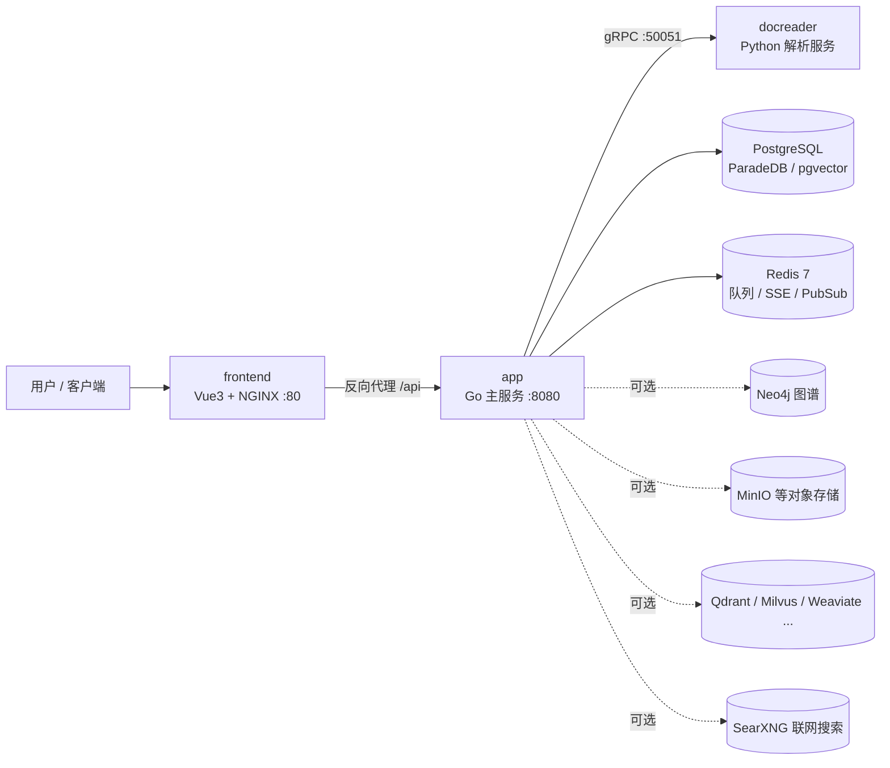
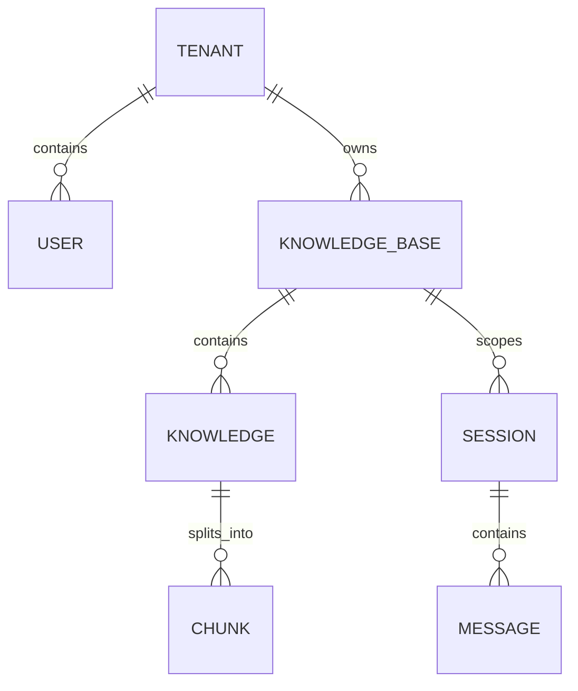

# WeKnora 设计文档（DESIGN.md）

> 版本：v0.8.3 ｜ 许可：MIT ｜ 模块路径：`github.com/Tencent/WeKnora`

WeKnora 是腾讯开源的、以大模型驱动的知识管理框架，面向企业级文档理解、语义检索与推理。它把团队文档汇聚到同一处知识库之上，提供三种可协同的能力：**RAG 问答**（可溯源的问答）、**Agent**（多步推理与工具调用）、**Wiki**（知识组织与图谱）。三者共享同一套知识库与检索底座。

本文档描述系统的整体设计：进程拓扑、后端分层、依赖注入、核心数据流（文档入库与检索问答）、以及横切关注点（多租户、鉴权、错误、日志、流式与引用）。

---

## 1. 设计目标与原则

| 目标 | 设计取向 |
| --- | --- |
| 能力可组合 | RAG / Agent / Wiki 共用知识库与检索层，避免能力孤岛 |
| 部署可伸缩 | 从单机 Lite（无 Redis）到 Docker Compose / Helm 集群形态平滑过渡 |
| 检索高可用 | 混合检索（向量 + 关键词）与多向量库后端可插拔 |
| 长任务可观测 | 文档入库全程异步化，进度树可视化、异常自愈 |
| 多租户安全 | tenant 级数据隔离 + 四角色 RBAC + 敏感字段静态加密 |
| 面向 Agent | 后端与 CLI 均提供机器可读契约（MCP、NDJSON 事件流） |

---

## 2. 总体架构

系统由**三个核心进程**与**基础设施**构成，可选组件按需启用。



### 2.1 进程职责

| 进程 | 技术 | 端口 | 职责 |
| --- | --- | --- | --- |
| `frontend` | Vue 3 + Vite + NGINX | 80 | SPA 界面、静态资源、反向代理 `/api` 到 app |
| `app` | Go + Gin | 8080 | 核心业务：鉴权、知识库、检索、会话、Agent、Wiki、异步任务编排 |
| `docreader` | Python + gRPC | 50051 | 文档解析与切分：多格式解析、OCR、分块，返回结构化文本 |

### 2.2 基础设施与可选组件

- **PostgreSQL（ParadeDB pg17）**：主库，内置 BM25 全文检索与 `pgvector` 向量检索，因此单库即可支撑混合检索。
- **Redis 7**：Asynq 任务队列、SSE 流状态、PubSub、限流。**是否存在 Redis 决定运行形态**：有则走 Asynq 分布式异步，无则退化为进程内 `SyncTaskExecutor`（Lite 模式）。
- **可选组件（Compose profile 按需开启）**：`neo4j`（知识图谱）、`minio`（对象存储）、`qdrant` / `milvus` / `weaviate`（外部向量库）、`doris`（分析）、`searxng`（联网搜索）、`dex`（OIDC 身份源）、`langfuse`（LLM 可观测）。

---

## 3. 技术栈

### 3.1 后端（Go 1.26）

| 领域 | 选型 |
| --- | --- |
| Web 框架 | Gin v1.12.0 |
| ORM / 迁移 | GORM v1.31.1 + golang-migrate v4.19.1 |
| 依赖注入 | uber/dig v1.19.0 |
| 任务队列 | hibiken/asynq v0.26.0 |
| RPC | google.golang.org/grpc v1.81.0 |
| 缓存/队列 | redis/go-redis v9.14.1 |
| 配置 | spf13/viper v1.21.0 |
| 日志 | sirupsen/logrus v1.9.4 + lumberjack 轮转 |
| 可观测 | OpenTelemetry v1.43.0（OTLP）+ Langfuse |
| 向量/图/存储 SDK | pgvector、milvus、qdrant、weaviate、neo4j、minio、COS、OSS、TOS、S3 等 |
| MCP | mark3labs/mcp-go v1.1.1 |
| API 文档 | swaggo/swag（`docs/swagger.*`） |

### 3.2 前端（Vue 3）

Vue ^3.5.34 + Vite ^7.3.5 + TypeScript ~6.0.3 + Pinia ^3.0.4 + vue-router ^4.5 + vue-i18n ^11.4.2；UI 组件库 tdesign-vue-next；渲染相关 marked / katex / mermaid / pdfjs-dist / docx-preview / xlsx；SSE 使用 `@microsoft/fetch-event-source`。

### 3.3 docreader（Python）

基于 gRPC，多解析器路由（PDF / DOCX / XLSX / PPTX / Markdown / HTML / EPUB / 图片 OCR / XMind 等），含 `source_locator`（源定位）、SSRF 防护、切分器与并发控制。

---

## 4. 后端分层与依赖注入

### 4.1 分层架构

```
Handler（HTTP 入参/出参、鉴权守卫）
   ↓
Service（业务编排、事务边界）
   ↓
Repository（数据访问，GORM）
   ↓
数据库
```

- 各层之间的**接口集中声明**在 `internal/types/interfaces/`，便于替换实现与测试打桩。
- 领域模型（GORM 实体）位于 `internal/models/`。

### 4.2 依赖注入（uber/dig）

- 采用**构造函数注入**，容器在入口 `internal/container/container.go` 的 `BuildContainer` 中统一装配。
- 用 `dig.Provide` 注册各层构造函数、`dig.Invoke` 触发实例化。
- 好处：新增模块只需追加 Provide 项，无需改动调用方；测试中可注入替身实现。

```go
// 示意：容器装配的关键形态（非真实源码，用于说明注入方式）
c := dig.New()
_ = c.Provide(repository.NewKnowledgeRepository) // Repository 层
_ = c.Provide(service.NewKnowledgeService)       // Service 层（依赖上面的接口）
_ = c.Provide(handler.NewKnowledgeHandler)       // Handler 层（依赖 Service 接口）
```

### 4.3 目录导览（顶层）

| 目录 | 说明 |
| --- | --- |
| `cmd/server` | Go 主服务入口（bootstrap / listen / 信号处理） |
| `cmd/desktop`、`cmd/milvus-migrate` | 桌面端壳、Milvus 迁移工具 |
| `internal/` | 全部后端模块（见下） |
| `docreader/` | Python 解析微服务 |
| `frontend/` | Vue 3 前端 |
| `client/` | Go SDK 客户端 |
| `cli/` | 面向 Agent 的命令行（NDJSON 契约） |
| `mcp-server/` | MCP Server（Python） |
| `config/`、`helm/`、`docker/` | 配置、K8s Helm Chart、镜像与脚本 |

`internal/` 关键模块：`handler` `types/interfaces` `models` `container` `database` `event` `stream` `modelcontext` `searchutil` `reranking` `mcpserver` `mcp` `sandbox` `browserskill` `agent` `datasource` `errors` `middleware` `router` `config` `logger` `ratelimit` 等。

---

## 5. 启动流程与优雅退出

`cmd/server` 采用**两段式优雅退出**：

1. `bootstrap.go` 完成配置加载、日志、数据库连接与迁移、DI 容器构建、路由装配。
2. `listen.go` 启动 HTTP 服务；`main.go` 监听信号（`signals_unix.go` / `signals_windows.go` 分平台），收到信号后先停止接收新请求（HTTP 优雅关闭），再释放后台资源（worker、连接池、SSE 流），确保在途任务与流式响应不被截断。

数据库迁移由 `internal/database/migration.go` 驱动，同时支持 PostgreSQL 与 SQLite（Lite），并有版本化 schema 与多组迁移测试保障。

---

## 6. 路由组织与鉴权（RBAC）

### 6.1 路由

路由按领域分组装配（知识库、文档、分块、FAQ、会话/消息、Agent、Wiki、模型、租户/组织、数据源、评估、MCP 等），集中在 `internal/router/`。

### 6.2 RBAC 守卫

- 多租户以 `tenant_id` 为隔离维度，数据访问全程带租户过滤。
- 四种角色按权限强弱排列：`owner > admin > contributor > viewer`。
- 路由装配阶段通过 `rbacGuards` 为每个端点绑定所需最小角色，越权访问在中间件层即被拦截，避免业务层重复校验。

---

## 7. 中间件

| 中间件 | 作用 |
| --- | --- |
| 认证 | JWT 校验（`golang-jwt/jwt`），解析身份与租户 |
| RBAC | 基于路由声明的角色守卫 |
| 跨域 | gin-contrib/cors |
| 限流 | `internal/ratelimit`（含 IP 维度 `ipclass`） |
| 日志/追踪 | 请求日志、OpenTelemetry Trace 贯穿 |
| 恢复/错误 | panic 恢复并统一转 `AppError` 响应 |

---

## 8. 领域模型与多租户

### 8.1 核心实体（约 26 个 GORM 实体）

围绕「租户 → 组织/成员 → 知识库 → 文档 → 分块」主干展开，另有会话/消息、Agent、Wiki、模型配置、标签、评估、数据源、MCP 等实体。主要关系：



### 8.2 安全设计

- **租户隔离**：所有查询强制带 `tenant_id`。
- **静态加密**：敏感字段（如密钥、凭据）采用 AES-256-GCM 加密存储。
- **凭据脱敏**：配置读取接口对密钥字段做 redact 后返回。

---

## 9. 文档入库管线

### 9.1 入口与存储

- 三种入库入口（表单上传、URL 抓取、数据源同步等）。
- 文件存储层支持多种后端（本地卷、MinIO、S3、COS、OSS、TOS 等）。
- 数据源连接器（`internal/datasource`）通过调度器（cron）周期性同步外部数据。

### 9.2 异步处理

- 有 Redis：任务投递到 **Asynq**，按用途划分 6 个 worker 池——`core(8)`、`postprocess(2)`、`enrichment(12)`、`maintenance(4)`、`shared(6)`、`wiki(8)`。
- 无 Redis（Lite）：退化为进程内 `SyncTaskExecutor` 同步执行，保持接口一致。

### 9.3 处理管线（五阶段）

解析（调用 docreader gRPC）→ 切分 → 向量化/入库 → 富化（关键词、摘要、图谱抽取等）→ 后处理（状态收尾、索引提交）。

### 9.4 状态机与可观测

- **Knowledge 七态**：`pending` → `processing` → `finalizing` → `completed`；异常分支 `failed` / `deleting` / `cancelled`。
- **Span Tracker**：以树形结构记录各处理阶段的耗时与进度，驱动前端进度展示。
- **Housekeeping 自愈**：每 5 分钟一轮、共三类 Sweep，扫描卡在中间态的任务并重置/失败，保证最终一致。

### 9.5 删除清理链路

删除知识库/文档时按依赖顺序清理：分块与向量 → 文件对象 → 关联会话引用 → 元数据记录，全程可重入，失败由 Housekeeping 兜底。

---

## 10. RAG 检索管线

### 10.1 事件驱动插件框架

检索问答采用**事件驱动插件管线**：`Plugin` 接口 + `EventManager` 责任链，全程共享 `ChatManage` 状态对象（承载请求参数、召回结果、消息与统计）。管线按请求动态组装（可跳过不适用阶段）。

### 10.2 管线阶段（按注册顺序）

```
LOAD_HISTORY → MEMORY_RECALL → QUERY_UNDERSTAND → CHUNK_SEARCH_PARALLEL
→ CHUNK_RERANK → WEB_FETCH → CHUNK_MERGE → FILTER_TOP_K
→ DATA_ANALYSIS → INTO_CHAT_MESSAGE → CHAT_COMPLETION_STREAM
```

| 阶段 | 职责 |
| --- | --- |
| LOAD_HISTORY | 加载会话历史 |
| MEMORY_RECALL | 跨会话长期记忆召回 |
| QUERY_UNDERSTAND | 改写、意图识别、关键词抽取 |
| CHUNK_SEARCH_PARALLEL | 并行多路召回（向量/关键词/FAQ/图片） |
| CHUNK_RERANK | 重排（`internal/reranking`） |
| WEB_FETCH | 联网补充（SearXNG 等） |
| CHUNK_MERGE / FILTER_TOP_K | 融合去重与截断 |
| DATA_ANALYSIS | 表格/数据分析类增强 |
| INTO_CHAT_MESSAGE | 组装上下文与引用 |
| CHAT_COMPLETION_STREAM | 调用大模型流式生成 |

### 10.3 混合检索（HybridSearch）

- **加权 RRF 融合**多路召回结果，跨 store 分组聚合。
- 支持**图片召回**（image_vector）与 **FAQ 迭代检索**。
- `internal/searchutil` 提供检索通用能力；向量库后端可插拔（pgvector / Milvus / Qdrant / Weaviate 等）。

### 10.4 Prompt 模板

`config/prompt_templates/` 提供 `system_prompt`、`rewrite`、`keywords_extraction`、`intent_prompts`、`generate_summary`、`generate_questions`、`generate_session_title`、`graph_extraction`、`context_template`、`fallback` 等，模板与管线阶段一一对应。

---

## 11. 流式与引用机制

### 11.1 流式传输

- `StreamManager` 有两种实现：内存版与 Redis 版（决定能否多实例共享流）。
- 通过 **SSE** 向前端推送分阶段事件（`response_type` 覆盖检索、思考、正文增量、引用、完成、错误等）。
- **断线续传**：客户端携带 `offset` 重连（`continue-stream`），服务端从记录点续放，保证长回答不因网络抖动丢失。

### 11.2 引用生成

- `internal/modelcontext/` 在**请求级别**为来源分配别名（`cN` 文档 / `wN` 网页 / `dN` 数据 / `bN` 分块），模型输出中的 `ref` 标签在渲染时展开为可点击引用。
- 资源句柄（`res://`）为图片、附件等提供统一别名与鉴权访问。

---

## 12. 错误处理与日志

### 12.1 统一错误载体 `AppError`

所有错误收敛为 `AppError`（`internal/errors/`），**错误码分段**：

| 区段 | 范围 |
| --- | --- |
| 通用 | 1000–1999 |
| 租户 | 2000–2099 |
| Agent | 2100–2199 |
| 向量库 | 2200–2299 |

解析类错误另有 `parse_error_codes.go`。Handler 层将 `AppError` 统一序列化为标准错误响应。

### 12.2 日志

logrus 结构化日志，配合 lumberjack 做大小/数量轮转；请求级携带 trace id，可关联 OpenTelemetry → Langfuse 链路，便于定位检索/生成各阶段问题。

---

## 13. 扩展点

| 扩展点 | 位置 | 说明 |
| --- | --- | --- |
| 检索插件 | chat_pipeline | 实现 `Plugin` 接口并注册，即可插入新阶段 |
| 向量库后端 | `internal/container/engine_factory.go` | 按配置构建不同向量引擎 |
| 数据源连接器 | `internal/datasource` | 按 `connector.go` 契约新增外部数据源 |
| 文档解析器 | `docreader/parser` | 实现解析器并注册到 `registry.py` |
| MCP 工具 | `internal/mcpserver`、`mcp-server/` | 对外暴露工具，供 Agent 调用 |
| 模型供应商 | `config/builtin_models.yaml`、`models.json` | 声明式内置模型/模型目录覆盖 |

---

## 14. 部署形态

| 形态 | 说明 |
| --- | --- |
| Docker Compose | `docker-compose.yml` 一键起 app + frontend + docreader + PG + Redis；可选组件用 profile 开启 |
| Kubernetes | `helm/` Chart（app / docreader / frontend / postgres / redis / neo4j / ingress / pvc / secrets） |
| Lite（单机轻量） | 无 Redis（进程内同步任务）、SQLite 可选，见 `docs/LITE.md`，含 systemd 服务与 Homebrew Formula |
| 桌面端 | `cmd/desktop` 提供本地代理与壳能力 |

---

## 15. 客户端与集成

| 客户端 | 说明 |
| --- | --- |
| `client/`（Go SDK） | 覆盖认证、知识库、知识、分块、会话、检索、SSE 流等 |
| `cli/` | 面向 AI Agent 的命令行：统一成功/错误 envelope + NDJSON 事件流（见 `cli/AGENTS.md`） |
| `mcp-server/` | 将 WeKnora 能力以 MCP 工具形式暴露给外部 Agent |
| Chrome 扩展 / 小程序 | BrowserSkill 操作浏览器；小程序端接入 |

---

## 附：相关文档

- 架构总览：`website-docs/02-architecture/01-overview.md`
- 后端设计：`website-docs/02-architecture/02-backend-design.md`
- 文档管线：`website-docs/02-architecture/03-document-pipeline.md`
- 检索管线：`website-docs/02-architecture/04-rag-pipeline.md`
- 变更记录：`CHANGELOG.md` ｜ 安全策略：`SECURITY.md`
