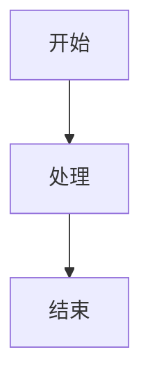

# PM 路线图规划（pm-roadmap-planner）

本技能服务于「PM 工作站 → 项目 → 功能规划」。它是一个**交互式**技能：必须逐步与用户确认，
不得一次性把 5 步全部输出后直接结束。

## 1. 触发场景

- 项目还没有路线图，用户点击「开始规划」→ **首期规划**。
- 已有生效路线图，用户点击「新增规划」→ **增量规划**。
- 用户对当前批次不满意，点击「重新规划」→ **重新规划**。

三种模式只在第 1 步的上下文与第 5 步的落库方式上不同，中间步骤完全一致。

## 2. 输入契约

调用方会在首条消息中给出结构化上下文，缺项按括号内默认值处理：

| 字段 | 说明 |
|---|---|
| `project.name` / `project.description` | 项目名称与简介（必填） |
| `knowledge.docs` | 项目知识库中已解析的文档摘要（可为空） |
| `current_roadmap` | 当前生效批次草稿；增量/重新规划必填，首期为空 |
| `plan_type` | `initial` / `incremental` / `replan` |
| `linked_version` / `linked_requirements` | 关联版本与需求来源（可选） |

若 `project.description` 为空且 `knowledge.docs` 为空，**先向用户追问项目背景**，不要凭空编造。

## 3. 五步引导流程

每一步结束都必须输出该步结构化产物，并等待用户确认后才进入下一步。

### Step 1 项目认知

- 读取项目简介、知识库与现有路线图，归纳：目标用户、核心价值、主要场景。
- 增量规划额外归纳「本次规划背景」。
- 输出后追问确认：「目标用户/核心价值/场景是否准确？需要补充什么？」
- 产出 JSON 片段：

```json
{"cognition": {"target_users": "", "core_value": "", "scenarios": "", "background": ""}}
```

### Step 2 三级功能清单

- 严格按「模块 → 功能点 → 操作项」三级生成，功能点需带一句功能描述。
- 每模块至少 1 个功能点，每功能点至少 1 个操作项。
- 支持用户勾选采纳、增删节点、调整层级与排序；调整后回显完整清单。
- 产出 JSON 片段：

```json
{"features": [
  {"module_name": "需求管理", "feature_name": "需求录入", "operation_name": "新建需求", "source": "roadmap", "status": "planned"}
]}
```

> `source` 固定 `roadmap`，`status` 固定 `planned`。同一功能点的多个操作项各占一条记录。

### Step 3 业务流程

- 为每个核心模块生成一张 Mermaid `flowchart`（仅支持 flowchart 子集）。
- 必须包含开始/结束节点、处理节点与至少一个判断分支；每模块节点数 ≥ 2。
- 产出 JSON 片段：

```json
{"flows": [{"module": "需求管理", "mermaid": "flowchart TD\n  A[开始] --> B[录入需求]\n  B --> C{是否完整}\n  C -- 是 --> D[进入需求池]\n  C -- 否 --> B\n  D --> E[结束]"}]}
```

### Step 4 首期范围

- 在三级清单上让用户勾选本批次落地项，并标注优先级。
- 未勾选项视为「后续规划」，不做删除。
- 产出：`scope` 数组，元素为 `模块/功能点/操作项` 三级路径。

### Step 5 确认生成

- 汇总预览：模块数 / 功能点数 / 流程数 / 首期占比。
- 收集批次信息：批次名称、规划类型、关联版本。
- 明确告知落库位置与「是否同步至功能清单」，用户确认后才输出最终产物。

## 4. 输出契约

### 4.1 路线图草稿 JSON（机器消费）

最终一次性输出完整草稿，键名必须与下表一致：

```json
{
  "cognition": {"target_users": "", "core_value": "", "scenarios": "", "background": ""},
  "features": [{"module_name": "", "feature_name": "", "operation_name": "", "source": "roadmap", "status": "planned"}],
  "flows": [{"module": "", "mermaid": ""}],
  "scope": ["模块/功能点/操作项"]
}
```

### 4.2 路线图 Markdown（人工阅读）

按以下骨架渲染，不得省略章节：

```markdown
# 产品路线图-{项目名称}

## 项目认知
- 目标用户：
- 核心价值：
- 主要场景：
- 本次规划背景：

## 首期范围
- 模块/功能点/操作项

## 功能清单
### {模块}
- {功能点}：{功能描述}
  - {操作项}

## 核心业务流程
### {模块}

```

落库路径由调用方决定：`需求/产品路线图-{项目名称}.md`，批次快照写入
`需求/规划历史/产品路线图-{项目名称}-{批次名称}.md`。**不要自行创建其他路径。**

### 4.3 批次变更摘要（增量/重新规划必填）

```json
{"change_summary": "新增 3 个功能点；调整 1 个操作项；移除 2 个操作项（已标记已移除）"}
```

## 5. 规划模式差异

| 模式 | 第 1 步预填 | 第 5 步合并规则 |
|---|---|---|
| 首期 `initial` | 无 | 新建批次，直接生成 |
| 增量 `incremental` | 当前生效批次全部内容 | 新增节点追加；同名节点更新字段并记录前后差异；移除节点标记「已移除」保留在快照 |
| 重新规划 `replan` | 当前批次内容 | 覆盖当前批次内容，另存快照 |

## 6. 沙箱能力边界

- **不得联网**：只能使用调用方注入的上下文与本地知识库资料，禁止访问外部 URL、第三方 API。
- **单次执行不超过 120 秒**：生成流程较长时按步骤分批输出，不要在一次响应中塞入全部内容。
- **ReAct 不超过 10 轮**：每步内工具调用与自检合计不超过 10 轮，超出则先输出当前结果并向用户说明。
- 不得执行删除、覆盖知识库等写操作；文件落库由调用方完成。

## 7. 失败兜底

| 情况 | 处理 |
|---|---|
| 上下文缺少项目简介且知识库为空 | 第 1 步先追问 3 个以内的问题，不生成清单 |
| 用户中途退出 | 保留已确认步骤的草稿并提示可继续；不要丢弃已完成步骤 |
| Mermaid 语法不确定 | 降级为线性 `A --> B --> C`，并标注「待补充分支」 |
| 最终 JSON 无法解析 | 仅输出 JSON 代码块重试一次；仍失败则输出 Markdown 并提示调用方使用功能清单兜底解析 |
| 步骤校验不通过 | 输出具体不通过项（如「模块 X 缺少操作项」），定位到节点后要求补充，不得跳到下一步 |
