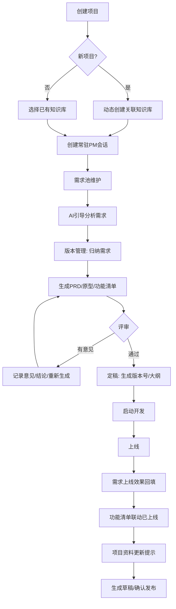
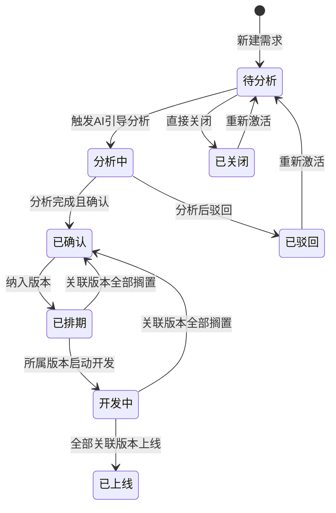
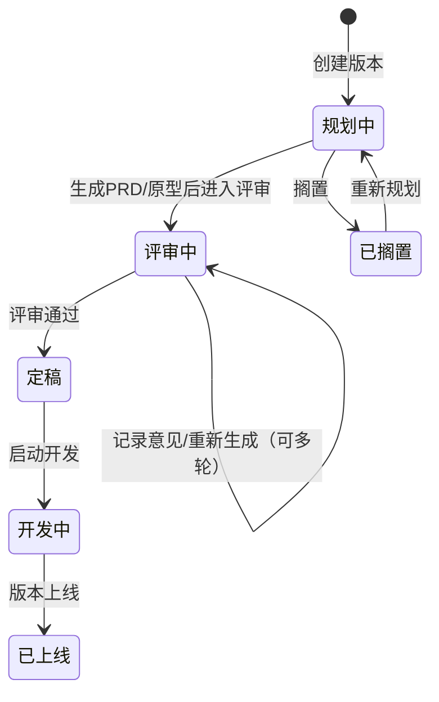

# PM 工作站 · 产品需求文档（PRD）

| 项目名称 | WeKnora PM 工作站模块 |
|:---|:---|
| 产品版本 | v1.0 |
| 文档状态 | 评审稿 |
| 编写日期 | 2026-10-19 |
| 适用端 | PC 端（WeKnora 平台内嵌模块） |

---

# 需求概述

## 需求背景

产品经理在 WeKnora 知识库平台上的日常工作中，需求管理、版本规划、PRD/原型产出、操作手册与宣传物料制作等环节彼此割裂：

- 需求零散记录在文档或聊天中，缺乏统一的需求池与状态跟踪；
- PRD、原型、操作手册、宣传册、PPT 依赖人工编写，重复劳动多、版本易漂移；
- 功能清单与版本上线状态脱节，需要人工维护、容易遗漏；
- 产品推进节奏（版本节点）缺少统一记录。

为解决上述问题，在 WeKnora 平台内嵌建设 **PM 工作站**模块，为产品经理提供需求的一站式管理能力：产品的方案规划、需求维护、方案及原型设计、产品版本维护，以及产品操作手册、宣传册、PPT 的自动更新，形成"需求 → 版本 → 功能清单 → 项目资料"的完整闭环。核心差异化在于 **AI 引导需求分析**（挖掘真实需求的价值、关联影响与风险、并给出设计方案）与 **PRD/原型/资料自动生成**（基于会话内技能）。

## 功能清单

| 所属端 | 一级菜单 | 二级菜单 | 功能点 |
|:---:|:---:|:---:|:---|
| PC 端 | 项目管理 | 项目列表 | 项目卡片/列表展示、筛选、归档、恢复 |
| PC 端 | 项目管理 | 新建项目 | 新项目（动态建知识库）、关联已有知识库 |
| PC 端 | 需求池 | 需求列表 | 列表/看板视图切换、筛选、状态流转 |
| PC 端 | 需求池 | 新建需求 | 表单填写基础信息、AI分析（含设计方案）、确认生成 |
| PC 端 | 需求池 | 需求详情 | 需求描述、AI分析意见与设计方案、关联版本、上线验证回填 |
| PC 端 | 功能规划 | 产品路线 | AI 引导规划核心功能模块/业务流程/核心功能 |
| PC 端 | 功能清单 | 功能清单 | 三级树形清单（含功能描述）、人工补充、版本上线联动、迭代历史 |
| PC 端 | 版本管理 | 版本列表 | 版本状态展示、计划/实际上线日、筛选 |
| PC 端 | 版本管理 | 版本详情 | 需求归纳、PRD/原型生成、评审意见与结论、定稿 |
| PC 端 | 版本管理 | 版本操作 | 生成、评审、重新生成、定稿、上线、搁置 |
| PC 端 | 项目资料 | 资料列表 | 资料卡片、版本号标记、更新提示 |
| PC 端 | 项目资料 | 资料管理 | 生成草稿、预览、发布、更新到最新版本 |

## 相关流程图

### 业务主流程



### 需求状态流转图



### 版本状态流转图



---

# 功能需求说明

PM 工作站子系统为 WeKnora 平台内嵌模块，包含 PC 端一个端。

PC 端由产品经理使用，用于项目与需求管理、版本规划与评审、PRD/原型/项目资料的自动生成与更新。

## 1 项目管理

### 1.1 项目列表

项目列表以"分组+筛选项+列表"的方式展示当前登录用户可见的全部项目数据，分组为"全部"与"已归档"两个分组，分组上需标注当前分组下的项目数量。

首次进入页面时需将所有查询条件初始化，并自动执行查询功能，默认展示"全部"分组的数据，以"创建时间"降序，支持分页展示。

**（1）字段说明**

| 字段名称 | 展示控制 | 备注 |
|:---:|:---|:---|
| 项目名称 | 文本，点击可打开项目工作台 | |
| 项目描述 | 文本，超长省略展示 | |
| 关联知识库 | 文本 | 项目创建时自动关联的知识库名称 |
| 状态 | 标签：活跃/已归档 | 活跃为绿色标签、已归档为灰色标签 |
| 负责人 | 文本 | 预留字段 |
| 创建时间 | 日期+时间，YYYY-MM-DD HH:MM:SS | |
| 操作列 | 超链接 | 归档、恢复、进入工作台 |

**（2）筛选项说明**

| 筛选项名称 | 数据来源 | 控制说明 |
|:---:|:---|:---|
| 搜索框 | 项目名称、项目描述 | 文本输入，模糊匹配，字符上限50 |
| 状态 | 项目状态 | 下拉单选，可选值为"全部、活跃、已归档"，默认"全部" |
| 创建时间 | 项目创建时间 | 日期范围选择，匹配创建时间在所选范围内的数据 |

**（3）数据权限说明**

页面数据无需做数据权限管理，拥有表单权限则可查看全部数据（当前为单人使用，数据模型预留负责人字段，后续多人升级时再行扩展）。

### 1.2 新建项目

点击"新建项目"按钮则打开新建项目弹框，需选择项目来源方式，分为 2 个模块：基本信息、知识库关联。

**（1）基本信息**

| 字段名称 | 控制说明 | 备注 |
|:---:|:---|:---|
| 项目名称 | 单行文本输入框，必填，字符上限50 | |
| 项目描述 | 多行文本输入框，必填，字符上限500 | |
| 负责人 | 单行文本输入框，非必填，字符上限20 | 预留字段 |

**（2）知识库关联**

| 字段名称 | 控制说明 | 备注 |
|:---:|:---|:---|
| 项目来源 | 单选组，必填，可选值为"新项目、已存在项目"，默认选中"新项目" | 选择"新项目"时系统自动创建关联知识库；选择"已存在项目"时展示知识库选择 |
| 关联知识库 | 下拉单选框，当"项目来源"选择"已存在项目"时展示，必填，可选项为当前平台中可访问的知识库列表 | |

**（3）提交**

点击提交时，则校验：
- 必填项是否填写，未填写则横幅提示、不可提交；
- 项目名称是否与列表已有数据重复，重复则横幅提示、不可提交；
- "已存在项目"场景下是否已选择知识库，未选择则横幅提示、不可提交。

通过校验则弹出确认弹框，确认后则执行以下操作，完成创建并进入项目工作台：
- 新项目：调用平台能力动态创建关联知识库，并自动创建该项目常驻 PM 会话；
- 已存在项目：直接关联所选知识库，并自动创建该项目常驻 PM 会话。

**（4）返回**

点击返回时校验当前弹框是否存在已修改内容，若有则弹出保存提示，确认后则不保存数据、关闭弹框并返回列表。

### 1.3 归档与恢复

**（1）归档**

可对状态为"活跃"的项目操作归档。点击列表操作列的"归档"按钮，则弹出归档确认弹框，确认后则项目状态置为"已归档"，数据保留（不物理删除），界面默认分组中不再展示、可在"已归档"分组查看。

归档项目不可新建需求、创建版本；归档状态不影响已有数据查看。

**（2）恢复**

可对状态为"已归档"的项目操作恢复。点击列表操作列的"恢复"按钮，则弹出恢复确认弹框，确认后则项目状态置为"活跃"，恢复全部操作能力。

## 2 需求池

### 2.1 需求列表

需求列表以"视图切换+筛选项"的方式展示当前项目下的全部需求数据，支持"列表视图"与"看板视图"两种视图模式，默认"列表视图"，可随时切换（视图偏好本地记忆，下次进入沿用）。

首次进入页面时需将所有查询条件初始化，并自动执行查询功能，默认展示"全部"数据，以"更新时间"降序，支持按"更新时间"与"优先级"切换排序（优先级为升序），支持分页展示。

**（1）视图切换**

页面顶部提供"列表/看板"视图切换控件，切换时保留当前筛选项与排序条件：
- **列表视图**：以"分组+表格"展示，分组为"全部"与各需求状态分组，分组上需标注当前分组下的需求数量；表格列展示需求完整字段；
- **看板视图**：以"需求状态分列"展示，将需求按状态分为 8 列——待分析/分析中/已确认/已排期/开发中/已上线/已驳回/已关闭，每列标注该状态下的需求数量；列内卡片展示核心信息（需求标题、优先级、需求来源、提出人、描述摘要、所属版本、价值达成），点击卡片打开需求详情；支持卡片拖拽跨列流转状态，目标状态需满足 §2.1（4）状态说明中的状态流转规则，不合法则拦截并横幅提示。

**（2）字段说明**

以下字段说明适用于两种视图：列表视图逐列展示；看板视图卡片展示核心字段（表中标注"看板卡片"者）。

| 字段名称 | 展示控制 | 备注 |
|:---:|:---|:---|
| 需求标题 | 文本，点击可打开需求详情 | 看板卡片 |
| 优先级 | 标签：P0/P1/P2/P3 | P0红色、P1橙色、P2蓝色、P3灰色；看板卡片 |
| 需求状态 | 标签：待分析/分析中/已确认/已排期/开发中/已上线/已驳回/已关闭 | 不同状态不同色；看板视图以分列区分，卡片内不重复展示 |
| 需求来源 | 标签：客户反馈/内部提出/数据分析/竞品分析/战略规划/其他 | 看板卡片 |
| 提出人 | 文本 | 看板卡片 |
| 需求描述 | 文本，卡片内单行省略展示 | 看板卡片 |
| 所属版本 | 文本，多个以逗号分隔 | 未排期则显示"未排期"；看板卡片 |
| 价值达成 | 标签：达成/部分达成/未达成 | 未回填则不显示；看板卡片 |
| 更新时间 | 日期+时间，YYYY-MM-DD HH:MM:SS | 列表视图列 |
| 操作列 | 超链接 | 列表视图操作列展示"详情、编辑、驳回、关闭、重新激活、上线验证、删除"；看板视图收起为卡片下拉菜单 |

**（3）筛选项说明**

| 筛选项名称 | 数据来源 | 控制说明 |
|:---:|:---|:---|
| 搜索框 | 需求标题、需求描述 | 文本输入，模糊匹配，字符上限50 |
| 优先级 | 需求优先级 | 下拉多选，可选值为 P0、P1、P2、P3 |
| 需求状态 | 需求状态 | 下拉多选，可选值为 待分析、分析中、已确认、已排期、开发中、已上线、已驳回、已关闭 |
| 需求来源 | 需求来源字段 | 下拉多选，可选值为 客户反馈、内部提出、数据分析、竞品分析、战略规划、其他 |
| 价值达成 | 价值达成字段 | 下拉多选，可选值为 达成、部分达成、未达成 |
| 提出人 | 提出人字段 | 文本输入，模糊匹配，字符上限20 |
| 所属版本 | 版本名称 | 下拉单选，可选值为当前项目的全部版本 |

**（4）状态说明**

| 状态名称 | 状态说明 | 可用功能 |
|:---:|:---|:---|
| 待分析 | 新建需求后的初始状态 | 产品经理：触发AI分析、编辑、关闭 |
| 分析中 | AI 分析进行中的状态 | 产品经理：查看分析过程 |
| 已确认 | AI 分析完成且人工确认后的状态 | 产品经理：编辑、纳入版本 |
| 已排期 | 需求已被纳入某版本、且关联版本均未启动开发的状态 | 产品经理：编辑、调整所属版本 |
| 开发中 | 需求关联的任一版本已启动开发的状态 | 产品经理：查看、调整所属版本 |
| 已上线 | 需求关联的全部版本均已上线的状态 | 产品经理：查看、上线验证回填 |
| 已驳回 | AI 分析后人工驳回的状态 | 产品经理：重新激活、删除 |
| 已关闭 | 需求被关闭（未采纳）的状态 | 产品经理：重新激活、删除 |

状态流转说明：需求状态除人工操作外，还随关联版本状态自动联动（由系统自动维护，不提供手工修改入口）：
- 关联任一版本由"定稿"变更为"开发中"时，需求状态自动由"已排期"变更为"开发中"；
- 当关联的全部版本均变更为"已上线"时，需求状态自动变更为"已上线"；仅部分版本上线时保持"开发中"；
- 当关联的全部版本均被搁置时，需求状态自动回落为"已确认"；仍存在未搁置版本时状态不变。

**（5）数据权限说明**

页面数据无需做数据权限管理，拥有表单权限则可查看当前项目全部需求数据。

### 2.2 新建需求（表单 + AI 分析）

点击"新建需求"按钮则打开新建需求弹窗，弹窗包含 2 个区域：需求信息、AI 分析结果（初始不展示）。

**（1）需求信息**

| 字段名称 | 控制说明 | 备注 |
|:---:|:---|:---|
| 需求标题 | 单行文本输入框，必填，字符上限100 | 允许先填初步想法标题 |
| 初步想法 | 多行文本输入框，必填，字符上限2000 | 用户对需求的最初描述 |
| 需求来源 | 下拉单选框，必填，可选值为"客户反馈、内部提出、数据分析、竞品分析、战略规划、其他"，默认"内部提出" | |
| 提出人 | 单行文本输入框，非必填，字符上限20，默认回显当前登录用户 | |
| 优先级 | 下拉单选框，非必填，可选值为 P0、P1、P2、P3 | 可由 AI 分析后建议，人工确认 |

**（2）AI 分析入口**

需求信息必填项（需求标题、初步想法）填写完成后，"AI 分析"按钮由置灰变为置亮、可点击；未填写完成时按钮置灰、不可点击。

点击"AI 分析"则打开 AI 分析弹窗（弹窗分为 2 个区域：AI 对话区、分析结果区）：

1. 系统在项目常驻 PM 会话中触发 `pm-requirement-analysis` 技能，以需求信息 + 项目产品路线图（功能规划产物） + 关联知识库为上下文，开启对话流式输出；
2. AI 基于需求现状（初步想法、当前产品路线与已有功能）连续追问澄清（每次最多提出 3 个问题），引导用户补充需求详细情况（使用场景、目标用户、约束条件等），用户逐轮回答；对话过程实时展示在对话区；
3. AI 分析完成后输出结构化分析结果（JSON）：需求价值、关联功能影响、风险、建议优先级、建议状态、**具体设计方案**，自动填充至 AI 弹窗"分析结果区"（该区域字段可手动修改）；
4. 用户在 AI 弹窗点击"完成分析"，关闭 AI 弹窗并**返回新建需求弹窗**。

**（3）AI 分析结果区（返回后展示）**

AI 分析完成后返回新建需求弹窗，弹窗下方展示"AI 分析结果"区域，分析结果自动填充并**可手动修改**：

| 展示项 | 控制说明 |
|:---:|:---|
| 需求价值 | 只读展示，AI 生成 |
| 关联功能影响 | 只读展示，AI 生成 |
| 风险 | 只读展示，AI 生成 |
| 建议优先级 | 下拉单选框，可修改，可选值为 P0、P1、P2、P3 | 默认 AI 建议值 |
| 建议状态 | 只读展示，AI 生成 |
| 具体设计方案 | 多行文本输入框，可修改，字符上限2000 | AI 生成后用户可直接修改 |

未进行 AI 分析时，弹窗不展示"AI 分析结果"区域。分析结果保留在弹窗内，关闭弹窗再打开（或从需求详情/操作列再次触发分析）时不丢失。

**（4）提交**

点击"完成"时，则校验：
- 必填项是否填写，未填写则横幅提示、不可提交；
- 需求标题是否与列表已有数据重复，重复则横幅提示、不可提交。

通过校验则保存数据，创建为"待分析"（未进行 AI 分析）或"已确认"（已完成 AI 分析）状态数据，关闭弹窗并返回需求列表；已分析的需求同步在关联知识库"需求/"目录创建需求详情文档（含设计方案章节）。

**（5）返回**

点击返回时校验当前弹窗是否存在已修改内容或对话进行中，若有则弹出保存提示，确认后则不保存数据、关闭弹窗并返回列表。

### 2.3 需求详情

点击需求卡片或操作列"详情"则打开需求详情页面，页面为特殊排版布局，分为 4 个区域：基本信息、AI 分析意见、版本关联、上线验证。

```
┌─────────────────────────────────────────────┐
│ 需求标题（大字号）    [状态标签] [优先级标签]    │
├──────────────────────┬──────────────────────┤
│ 基本信息              │  AI 分析意见           │
│ · 需求来源            │  ┌──────────────────┐ │
│ · 提出人              │  │ 价值: ...        │ │
│ · 创建/更新时间        │  │ 关联影响: ...    │ │
│ · 需求描述（全文）      │  │ 风险: ...        │ │
│ · 所属版本            │  │ 建议优先级: ...  │ │
│                      │  │ 设计方案: ...    │ │
│ [编辑] [重新分析]     │  │ [编辑设计方案]    │ │
│                      │  └──────────────────┘ │
├──────────────────────┴──────────────────────┤
│ [关联需求文档]（知识库"需求/"目录）             │
├─────────────────────────────────────────────┤
│ 上线验证（需求"已上线"后展示）                  │
│ · 实际上线时间 / 效果数据 / 复盘说明            │
│ · 价值达成: [达成]  [回填验证]                 │
└─────────────────────────────────────────────┘
```

详情页面内容均不可直接编辑；点击"编辑"则打开修改弹框（字段与新增一致，回显已有数据），点击"重新分析"则重新触发 AI 分析（AI 分析弹窗，流程与新建时一致，分析结果覆盖原 AI 分析意见与设计方案），点击"编辑设计方案"则打开设计方案编辑弹框（多行文本，字符上限2000，回显当前设计方案，可修改保存）。

需求状态为"已上线"后，详情页新增"上线验证"区域，展示该需求的实际上线时间、效果数据、复盘说明与价值达成结果，并支持点击"回填验证"更新；未上线时不展示该区域。

### 2.4 其他操作项

**（1）编辑**

"待分析、已确认、已排期"状态的需求可进行修改。点击操作列的"编辑"按钮则打开修改弹框，字段与新增时一致，回显已有数据。其中"需求标题、提出人、具体设计方案"可修改（设计方案亦可从需求详情"编辑设计方案"入口修改），"初步想法、AI 分析意见（价值/关联影响/风险/建议状态）"不可修改（需通过"重新分析"更新）。

提交、返回操作与新建时一致。

**（2）驳回**

可对"分析中"完成分析的需求操作驳回。点击操作列的"驳回"按钮，则弹出驳回确认弹框，确认后需求状态置为"已驳回"，AI 分析结论保留。

**（3）关闭**

可对"待分析"状态的需求操作关闭。点击操作列的"关闭"按钮，则弹出关闭确认弹框，确认后需求状态置为"已关闭"。

**（4）重新激活**

可对"已驳回、已关闭"状态的需求操作重新激活。点击操作列的"重新激活"按钮，则弹出重新激活确认弹框，确认后需求状态置为"待分析"，保留历史状态记录与 AI 分析意见。

**（5）删除**

可对**未纳入版本**的需求操作删除（不限状态，如"待分析、已驳回、已关闭"等）。点击列表操作列或需求详情的"删除"按钮，则进行如下校验：
- 需求已被纳入版本（存在版本关联记录）时，不可删除，横幅提示"已纳入版本的需求不可删除"；
- 校验通过则弹出删除确认弹框，确认后删除对应的需求数据及关联文档（含知识库"需求/"目录下的需求详情文档）。

**（6）上线验证回填**

可对"已上线"状态的需求执行上线验证回填。点击操作列或详情页的"上线验证"按钮，则打开回填弹框。

| 字段名称 | 控制说明 | 备注 |
|:---:|:---|:---|
| 实际上线时间 | 只读展示 | 取该需求关联版本的最后上线日期 |
| 效果数据 | 多行文本输入框，非必填，字符上限1000 | 上线后的量化效果/指标数据 |
| 价值达成 | 单选组，必填，可选值为"达成、部分达成、未达成" | 用于需求列表"价值达成"标签与需求池统计展示 |
| 复盘说明 | 多行文本输入框，非必填，字符上限1000 | 复盘结论与后续改进说明 |

提交校验必填项后保存至该需求，同步更新需求列表的"价值达成"字段。

**（7）版本管理同步说明**

需求池为需求的唯一主数据源，需求状态与所属版本由版本管理侧驱动实时同步，无需在需求池人工维护：
- 需求纳入版本（新建版本需求归纳）后，需求状态置为"已排期"、所属版本显示对应版本；
- 版本管理中执行需求级"取消、搁置、变更"（详见 5.4）时，需求池同步更新需求状态、所属版本及优先级/描述等字段；
- 版本"搁置、启动开发、上线"时，需求池按既定联动规则更新需求状态（详见 5.9）。

## 3 功能规划

### 3.1 功能规划（产品路线）

功能规划是贯穿项目全生命周期的持续规划过程，不局限于项目立项阶段：项目创建后通过"首期规划"建立产品骨架，项目推进过程中可结合新需求、版本节奏与阶段复盘随时发起"迭代规划"，持续补充与修正核心功能模块、核心业务流程与核心功能范围。每次规划形成一条规划批次记录，支持回溯查看历史批次。

功能规划页面以"路线图视图 + 规划引导视图"的方式展示，路线图默认展示当前生效批次的规划内容。

**（1）路线图展示**

| 展示项 | 展示控制 | 备注 |
|:---:|:---|:---|
| 规划批次 | 批次条横向平铺切换（当前选中批次高亮），批次条右侧展示"本次变更"摘要、批次状态标签与"查看快照"入口 | 默认选中当前生效批次；点击历史批次查看快照内容 |
| 核心功能模块 | 三级树形清单：模块 → 功能点 → 操作项，功能点展示功能描述 | 由规划引导产出，可一键同步至功能清单 |
| 核心业务流程 | 可视化流程图，按模块切换查看，支持放大查看 | 每个核心模块至少 1 条主流程 |
| 核心功能 | 按模块汇总的功能点清单，标记首期范围与后续规划 | 便于快速了解规划边界 |

首次进入功能规划页面时，若该项目尚无路线图，则自动进入"开始规划"AI 引导规划页面（详见 3.2）：AI 基于项目名称/描述与知识库上下文连续提问澄清，产出三级功能清单与可视化流程图，确认后保存为路线图文档（存知识库），并作为后续需求 AI 分析与 PRD 生成的骨架输入（需求 AI 分析、版本 PRD/原型生成均以路线图为上下文）。

**（2）操作区**

| 操作 | 说明 |
|:---:|:---|
| 新增规划 | 主按钮。已有路线图时进入增量规划：预填当前路线图，标注本次新增/调整内容，确认后合并生成新批次（详见 3.2）；尚无路线图时按钮文案为"开始规划"，进入首期规划 |
| 重新规划 | 对当前批次重新走一次引导流程，确认后覆盖该批次内容 |
| 规划历史 | 打开规划批次列表，查看历次规划的批次名称、规划类型、关联版本、变更摘要、操作人、时间与状态，并可查看批次快照 |
| 查看快照 | 位于批次条右侧，打开当前选中批次的快照文档（只读） |

说明：路线图节点内容的调整统一在规划引导（或"重新规划"）中完成，路线图视图不单独提供"编辑"入口，避免绕过批次记录产生无快照的内容变更。

**（3）持续规划场景**

| 触发场景 | 说明 | 规划类型 |
|:---:|:---|:---|
| 项目立项 | 建立产品骨架，确定首期模块、流程与功能范围 | 首期规划 |
| 版本规划前 | 版本排期前补充或调整本版本涉及的核心功能与业务流程 | 迭代规划 |
| 需求回流 | 需求池中高价值需求指向规划外的能力时，补充规划并记录来源需求 | 迭代规划 |
| 阶段复盘 | 按季度/月度复盘，调整模块优先级与功能范围 | 迭代规划 |

**（4）数据权限说明**

页面数据无需做数据权限管理，拥有表单权限则可查看与操作当前项目路线图。

### 3.2 规划引导（AI 引导规划）

点击"开始规划""新增规划"或"重新规划"进入 AI 引导规划页面，页面采用"左引导对话 + 右路线图草稿"的双栏布局，顶部为 5 步步骤条，底部为操作条。引导过程复用项目常驻 PM 会话，支持自然语言输入与快捷选项，AI 基于项目名称/描述、知识库资料、已有路线图与需求池内容连续追问澄清。

规划模式分三种：

| 模式 | 入口 | 预填内容 | 生成方式 |
|:---:|:---|:---|:---|
| 首期规划 | 开始规划（无路线图） | 无，AI 从项目资料生成初版 | 新建批次 |
| 增量规划 | 新增规划（已有路线图） | 预填当前生效批次的全部内容，AI 标注新增/调整建议 | 与当前路线图合并，生成新批次 |
| 重新规划 | 重新规划（当前批次） | 预填当前批次内容 | 覆盖当前批次 |

**（1）页面布局**

```
┌────────────────────────────────────────────────────────────────────────────┐
│ 功能规划 / 新增规划（AI 引导 · 增量）                          [退出引导]  │
├────────────────────────────────────────────────────────────────────────────┤
│ 产品路线规划   当前生效批次：V1.2 迭代规划，本次将在现有路线图上补充调整    │
├────────────────────────────────────────────────────────────────────────────┤
│ ① 项目认知 │ ② 功能清单 │ ③ 业务流程 │ ④ 首期范围 │ ⑤ 确认生成            │
├────────────────────────────────────┬───────────────────────────────────────┤
│ AI 引导       第 2/5 步 · 功能清单  │ 路线图草稿             实时更新       │
│ ┌────────────────────────────────┐ │ ┌───────────────────────────────────┐ │
│ │ AI：已按三级结构生成功能清单…  │ │ │ 项目认知                 已确认   │ │
│ │ ┌────────────────────────────┐ │ │ ├───────────────────────────────────┤ │
│ │ │ 需求管理                    │ │ │ │ 核心功能清单        3 模块 9 功能 │ │
│ │ │  ├ 需求录入                │ │ │ │ ▾ 需求管理                        │ │
│ │ │  │  └ 新建需求（两步表单）│ │ │ │   ▾ 需求录入             2 项    │ │
│ │ │  └ 需求分析                │ │ │ │     新建需求 · 批量导入          │ │
│ │ └────────────────────────────┘ │ │ ├───────────────────────────────────┤ │
│ │ [＋新增模块][＋新增功能点]     │ │ │ 核心业务流程        可视化       │ │
│ └────────────────────────────────┘ │ │ ┌───────────────────────────────┐ │ │
│ [输入补充说明…]               [发送] │ │ │  开始→提交→AI分析→确认→上线  │ │ │
│                                     │ │ └───────────────────────────────┘ │ │
│                                     │ ├───────────────────────────────────┤ │
│                                     │ │ 首期范围                 6/9 项   │ │
│                                     │ └───────────────────────────────────┘ │
├────────────────────────────────────┴───────────────────────────────────────┤
│ [上一步] [下一步]  草稿自动保存，中途退出可继续（第 5 步主按钮为"完成规划"）│
└────────────────────────────────────────────────────────────────────────────┘
```

布局约束：
- 左右双栏等高（同一行网格拉伸对齐），左栏与右栏卡片底边齐平；
- 左栏为纵向弹性布局：对话区自适应填充剩余空间并可内部滚动，输入框始终固定在卡片底部，不在输入框下方留白；
- 底部操作条仅保留"上一步 / 下一步"两个主操作与自动保存提示，不设独立的"完成规划"按钮。

**（2）步骤说明**

| 步骤 | 名称 | 引导内容 | 产出 |
|:---:|:---:|:---|:---|
| 1 | 项目认知 | AI 读取项目简介、知识库与现有路线图，输出目标用户、核心价值与主要场景，通过多轮追问确认；增量规划时补充"本次规划背景"（关联版本/需求来源） | 项目认知信息 |
| 2 | 功能清单 | AI 按"模块 → 功能点 → 操作项"三级结构生成初版功能清单，功能点带功能描述（上限 500 字）；支持勾选采纳、新增/删除节点、调整层级与排序 | 三级功能清单 |
| 3 | 业务流程 | 为每个核心模块生成可视化流程图（开始/结束、处理节点、判断分支），支持拖拽调整顺序、增删节点、双击改名、为判断节点添加分支、切换模块 | 可视化流程图 |
| 4 | 首期范围 | 在三级清单上勾选本批次落地范围并标注优先级；未勾选的功能点标记为"后续规划" | 首期范围 |
| 5 | 确认生成 | 汇总预览（模块数/功能点数/流程数/首期范围占比）、批次信息（批次名称、规划类型、关联版本）与文档落库位置，确认后生成 | 路线图文档与批次记录 |

**（3）草稿区说明**

| 展示项 | 说明 |
|:---:|:---|
| 项目认知 | 步骤 1 确认后生成，返回步骤 1 可修改 |
| 核心功能清单 | 步骤 2 三级树实时同步，展开到功能点层级；增量规划时新增节点带"新增"标记、调整节点带"调整"标记 |
| 核心业务流程 | 步骤 3 各模块流程图实时同步，展示迷你流程图，点击可放大查看与编辑 |
| 首期范围 | 步骤 4 勾选结果实时同步，显示已选/总数 |

草稿随步骤操作实时更新，切换步骤不丢失；当前步骤对应的草稿区块高亮展示。中途退出自动保存草稿，再次进入可从上次步骤继续。

**（4）操作说明**

| 操作 | 说明 |
|:---:|:---|
| 上一步 | 返回上一引导步骤，已填内容保留 |
| 下一步 | 校验当前步骤：步骤 1 需确认项目认知；步骤 2 至少 1 个模块且每个模块至少 1 个功能点、功能点至少关联 1 个操作项；步骤 3 每个模块至少 1 条流程且流程节点不少于 2 个；步骤 4 至少勾选 1 个功能点；未通过则横幅提示并定位问题项 |
| 完成规划 | 仅在第 5 步出现：主按钮文案由"下一步"切换为"完成规划"，校验通过后生成文档与批次记录；底部不设独立按钮 |
| 退出引导 | 保留草稿并返回路线图视图，不生成文档 |

**（5）生成规则**

完成规划后生成《产品路线图》Markdown 文档，写入知识库"需求/"目录（命名：`产品路线图-{项目名称}.md`，为当前生效版本），页面返回功能规划视图展示最新路线图。文档包含项目认知、核心功能清单（三级）、核心业务流程（Mermaid 流程图代码 + 渲染图）、首期范围四部分，作为需求 AI 分析、版本 PRD/原型生成的骨架上下文。

增量规划按以下规则合并：新增模块/功能点/操作项追加写入；同名节点做字段更新，并在批次变更摘要中记录前后差异；移除的节点不物理删除，标记为"已移除"并保留在批次快照中。重新规划直接覆盖当前批次内容。

**（6）规划批次与历史**

| 字段 | 说明 |
|:---:|:---|
| 批次名称 | 默认按"首期规划""{版本号} 规划""{YYYY-MM} 迭代规划"生成，可修改 |
| 规划类型 | 首期规划 / 迭代规划 |
| 关联版本 | 选填，可从当前项目的版本列表中选择，用于版本规划前的规划 |
| 变更摘要 | 本次新增/调整/移除的模块、功能点、流程节点数量与明细 |
| 操作人 / 规划时间 | 记录发起规划的用户与完成时间 |
| 状态 | 草稿 / 生效中 / 已归档；同一时间仅一个批次为"生效中" |

每次规划生成一份批次快照，存储于知识库"需求/规划历史/产品路线图-{项目名称}-{批次名称}.md"；路线图视图可切换批次查看快照内容。

**（7）可视化流程图规范**

| 项 | 说明 |
|:---:|:---|
| 节点类型 | 开始/结束（椭圆）、处理节点（矩形）、判断节点（菱形，含是/否双分支） |
| 编辑操作 | 拖拽调整节点顺序、双击修改节点名称、节点右键增删、判断节点添加分支、跨行回流连线 |
| 展示控制 | 按模块切换；节点过多时支持缩放与全屏查看 |
| 存储形式 | Markdown 文档中以 Mermaid `flowchart` 代码块保存，同时导出渲染图片存入文档附件，便于未支持 Mermaid 的阅读场景 |

**（8）与功能清单的同步**

确认生成时勾选"同步至功能清单"，将三级清单按"模块名称 / 功能点 / 操作项"写入功能清单（状态为"规划"，来源标记为"路线图规划"）：已存在同名模块/功能点时按名称匹配更新功能描述与操作项，不存在则新增。未勾选则仅生成路线图文档，功能清单仍由版本上线联动维护。

**（9）数据权限说明**

无需单独的数据权限管理，拥有表单权限即可进入规划引导并生成路线图。

## 4 功能清单

### 4.1 功能清单列表

功能清单以"模块分组+树形列表"的方式展示当前项目的全部功能点，结构为三级：模块（一级）→ 功能点（二级）→ 操作项（三级）。

首次进入页面时自动执行查询功能，以"模块名称"分组、分组内按"创建时间"升序展示，支持分页展示。

**（1）字段说明**

| 字段名称 | 展示控制 | 备注 |
|:---:|:---|:---|
| 模块名称 | 文本，分组标题 | 一级节点 |
| 功能点 | 文本，缩进展示 | 二级节点 |
| 功能描述 | 文本，缩进展示，超长单行截断、悬浮展示全文 | 功能点的能力说明，PRD 同步时自动填充，人工补充时可编辑 |
| 操作项 | 文本，缩进展示 | 三级节点 |
| 来源需求 | 文本，点击可打开需求详情 | 功能点对应的来源需求 |
| 迭代版本 | 文本，多个以逗号分隔，按版本规划时间升序 | 功能点参与迭代的全部版本；未纳入版本则显示"未规划" |
| 状态 | 标签：规划/已上线 | 由最新迭代版本状态联动：最新迭代版本已上线则为"已上线"，否则为"规划" |
| 操作列 | 超链接 | 迭代历史、修改、删除 |

**（2）筛选项说明**

| 筛选项名称 | 数据来源 | 控制说明 |
|:---:|:---|:---|
| 搜索框 | 模块名称、功能点、操作项 | 文本输入，模糊匹配，字符上限50 |
| 迭代版本 | 版本名称 | 下拉单选，可选值为当前项目的全部版本，匹配功能点参与迭代的历史版本 |
| 状态 | 功能状态 | 下拉单选，可选值为"全部、规划、已上线" |

**（3）状态说明**

| 状态名称 | 状态说明 | 可用功能 |
|:---:|:---|:---|
| 规划 | 功能点参与迭代的最新版本尚未上线时的状态 | 产品经理：编辑、删除、查看迭代历史 |
| 已上线 | 功能点参与迭代的最新版本上线后自动联动变更的状态 | 产品经理：查看迭代历史 |

状态流转说明：功能点状态由其"最新迭代版本"（该功能点参与迭代的版本中规划时间最晚者）状态自动联动——最新迭代版本状态变更为"已上线"时，功能点状态自动置为"已上线"，否则保持"规划"；该状态由系统自动维护，不提供手工修改入口。功能点参与迭代的每次变更均保留迭代历史记录，各版本迭代历史不因最新版本状态变化而丢失。

**（4）数据权限说明**

页面数据无需做数据权限管理，拥有表单权限则可查看当前项目全部功能清单数据。

### 4.2 新增功能点（人工补充）

点击"新增功能点"按钮则打开新增功能点弹框，用于补充 PRD 自动同步之外的自由描述功能点。

**（1）字段说明**

| 字段名称 | 控制说明 | 备注 |
|:---:|:---|:---|
| 模块名称 | 单行文本输入框，必填，字符上限50 | 可新建模块或选择已有模块 |
| 功能点 | 单行文本输入框，必填，字符上限100 | |
| 功能描述 | 多行文本输入框，非必填，字符上限500 | 说明功能点的业务价值与能力边界，PRD 自动同步时由系统填充 |
| 操作项 | 单行文本输入框，非必填，字符上限100 | 可填写多个，逗号分隔 |
| 来源需求 | 下拉单选框，非必填，可选项为当前项目"已确认/已排期"状态的需求 | |
| 迭代版本 | 下拉多选框，非必填，可选项为当前项目的全部版本 | 保存后按版本规划时间为该功能点生成迭代历史记录 |

**（2）提交**

点击提交时，则校验：
- 必填项是否填写，未填写则横幅提示、不可提交；
- 同模块下功能点是否重复，重复则横幅提示、不可提交。

通过校验则保存数据至功能清单列表中、创建为"规划"状态数据，关闭弹框并返回功能清单列表。

**（3）修改**

可对"规划"状态的功能点进行修改。点击操作列的"修改"按钮则打开修改弹框，字段与新增时一致，回显已有数据。"已上线"状态的功能点不可修改、删除。

**（4）删除**

可对"规划"状态的功能点操作删除。点击操作列的"删除"按钮，则弹出删除确认弹框，确认后删除对应的功能点数据。

**（5）迭代历史**

可查看功能点的迭代变更历史。点击操作列的"迭代历史"按钮，则打开迭代历史弹框，按变更时间倒序展示该功能点的历次迭代记录。

| 字段名称 | 控制说明 | 备注 |
|:---:|:---|:---|
| 迭代版本 | 只读展示 | 本次变更所属的版本 |
| 变更类型 | 标签：新增/变更/移除 | 由系统按 PRD 同步结果自动生成 |
| 变更说明 | 只读展示 | 本次新增/变更/移除的内容摘要（变更时含功能描述的前后差异） |
| 变更时间 | 只读展示，YYYY-MM-DD HH:MM:SS | |

迭代历史由系统在版本 PRD 生成/重新生成时按最新 PRD 增量同步自动记录，不提供人工编辑入口；功能点被标记移除时，最后一条记录变更类型为"移除"。

## 5 版本管理

### 5.1 版本列表

版本列表以"分组+筛选项+列表"的方式展示当前项目下的全部版本数据，分组为各版本状态分组+全部，分组上需标注当前分组下的版本数量。

首次进入页面时需将所有查询条件初始化，并自动执行查询功能，默认展示"全部"分组的数据，以"创建时间"降序，支持分页展示。

**（1）字段说明**

| 字段名称 | 展示控制 | 备注 |
|:---:|:---|:---|
| 版本号 | 文本，点击可打开版本详情 | 定稿前显示"未定稿" |
| 版本名称 | 文本 | 非必填 |
| 版本状态 | 标签：规划中/评审中/定稿/开发中/已上线/已搁置 | 不同状态不同色 |
| 包含需求数 | 数字 | 该版本关联的需求数量 |
| 规划日期 | 日期，YYYY-MM-DD | |
| 计划上线日 | 日期，YYYY-MM-DD | 规划时填写的计划上线时间 |
| 定稿日期 | 日期，YYYY-MM-DD | 未定稿则不显示 |
| 上线日期 | 日期，YYYY-MM-DD | 未上线则不显示 |
| 操作列 | 超链接 | 详情、生成、评审、定稿、搁置、上线 |

**（2）筛选项说明**

| 筛选项名称 | 数据来源 | 控制说明 |
|:---:|:---|:---|
| 搜索框 | 版本号、版本名称 | 文本输入，模糊匹配，字符上限50 |
| 版本状态 | 版本状态 | 下拉多选，可选值为 规划中、评审中、定稿、开发中、已上线、已搁置 |
| 创建时间 | 版本创建时间 | 日期范围选择，匹配创建时间在所选范围内的数据 |

**（3）状态说明**

| 状态名称 | 状态说明 | 可用功能 |
|:---:|:---|:---|
| 规划中 | 创建版本后的初始状态 | 产品经理：编辑需求集合、生成PRD/原型、搁置 |
| 评审中 | 生成 PRD/原型后进入评审的状态 | 产品经理：记录评审意见、重新生成、定稿、搁置 |
| 定稿 | 评审通过并锁定版本号的状态 | 产品经理：启动开发 |
| 开发中 | 定稿后进入开发的状态 | 产品经理：上线 |
| 已上线 | 版本正式上线的状态 | 产品经理：查看 |
| 已搁置 | 版本被搁置的状态 | 产品经理：重新规划 |

**（4）数据权限说明**

页面数据无需做数据权限管理，拥有表单权限则可查看当前项目全部版本数据。

### 5.2 新建版本（需求归纳）

点击"新建版本"按钮则打开新建版本弹框，分为 2 个模块：版本信息、需求归纳。

**（1）版本信息**

| 字段名称 | 控制说明 | 备注 |
|:---:|:---|:---|
| 版本名称 | 单行文本输入框，必填，字符上限50 | |
| 版本说明 | 多行文本输入框，非必填，字符上限500 | |
| 规划日期 | 日期选择，必填，默认当前日期 | |
| 计划上线日 | 日期选择，必填，需晚于规划日期 | 记录版本计划上线时间，用于排期管理与计划/实际上线对比 |

**（2）需求归纳**

| 字段名称 | 控制说明 | 备注 |
|:---:|:---|:---|
| 选择需求 | 多选列表（复选框），可选项为当前项目"已确认"状态的需求，支持按优先级筛选 | 已关联其他未定稿版本的需求可重复选择（多对多） |

**（3）提交**

点击提交时，则校验：
- 必填项是否填写，未填写则横幅提示、不可提交；
- 计划上线日是否晚于规划日期，不满足则横幅提示、不可提交；
- 是否至少选择 1 个需求，未选择则横幅提示、不可提交。

通过校验则保存数据至版本列表中、创建为"规划中"状态数据，关闭弹框并返回版本列表。

### 5.3 版本详情

点击版本号或操作列"详情"则打开版本详情页面，页面为特殊排版布局，分为 4 个区域：版本信息、需求集合、产物（PRD/原型）、评审记录。

```
┌────────────────────────────────────────────────┐
│ 版本号（定稿后显示）  版本名称   [状态标签]       │
├───────────────┬────────────────────────────────┤
│ 版本信息        │  产物（PRD/原型）              │
│ · 规划日期      │  PRD-v1  [查看]  [重新生成]   │
│ · 计划上线日    │  原型-v1  [预览]  [重新生成]   │
│ · 定稿/上线日   │  功能清单  [查看]             │
│ · 更新内容大纲   │                               │
│ · 需求集合(数量) │                               │
│ [生成] [定稿]   │                               │
├───────────────┴────────────────────────────────┤
│ 评审记录                                        │
│ 第1轮 2026-10-19 [结论:有条件通过] 参会人: 张/李 │
│ 意见1: ...[已解决]  功能变更明细... [重新生成]   │
└────────────────────────────────────────────────┘
```

版本详情页面内容均不可直接编辑；各操作通过页面操作按钮与弹框完成。

各区域内容说明：

| 区域 | 内容 |
|:---|:---|
| 顶部 | 版本号、版本名称、版本状态标签；右上角为操作按钮区（生成、记录意见、重新生成、定稿、启动开发、上线、搁置），按钮按版本状态控制可用性 |
| 版本信息 | 规划日期、计划上线日、定稿日期、上线日期、版本说明、更新内容大纲 |
| 需求集合 | 展示关联需求的优先级、需求标题、需求状态，支持点击跳转需求详情；"规划中/评审中"状态版本支持对单条需求执行"搁置、取消、变更"操作（详见 5.4） |
| 产物 | PRD 文档、交互原型、功能清单（同步数量与状态），PRD/原型支持查看、预览、下载，并展示最近生成时间 |
| 评审记录 | 按轮次倒序展示评审结论、参会人、评审意见（含处理状态与处理说明）、功能变更明细；支持对单条意见修改处理状态 |

### 5.4 需求集合变动操作（搁置 / 取消 / 变更）

"规划中、评审中"状态的版本，其需求集合支持对单条需求执行"搁置、取消、变更"操作。点击版本详情"需求集合"区域中该需求行的操作链接打开对应弹框；"定稿"后需求集合锁定，不再支持上述操作。

**（1）取消（移出本版本）**

将需求从当前版本的需求集合移除，需求本身保留有效。点击"取消"则弹出取消确认弹框，确认后执行：
- 删除该需求与当前版本的关联记录；
- 联动需求池：若该需求不再关联任何版本 → 需求状态回退为"已确认"，所属版本置为"未排期"；若仍关联其他未定稿版本 → 需求状态保持"已排期"，所属版本更新为剩余关联版本。

**（2）搁置（评审不通过，需求暂停）**

评审中发现需求存在问题，将需求从版本中搁置。点击"搁置"则弹出搁置确认弹框（含搁置原因），确认后执行：
- 删除该需求与当前版本及全部关联版本的关联记录；
- 需求状态置为"已驳回"，记录搁置原因（作为驳回原因展示）；
- 联动需求池：需求状态"已驳回"、所属版本"未排期"；
- 后续可在需求池对该需求执行"重新激活"（置为"待分析"）重新走分析流程。

**（3）变更（调整字段 / 更换需求）**

点击"变更"则打开需求变更弹框，支持两种变更方式：

| 方式 | 说明 | 联动需求池 |
|:---|:---|:---|
| 变更字段 | 调整需求优先级、需求描述（回显当前值，可修改保存） | 实时同步需求池对应字段 |
| 更换需求 | 从当前版本移除原需求，在项目"已确认"需求中选择替代需求加入本版本 | 原需求若不再关联任何版本 → 状态回退"已确认"；替代需求状态置为"已排期" |

**（4）同步机制**

需求池为需求的唯一主数据源。版本管理中"需求归纳（纳入版本）"与"需求集合变动（搁置/取消/变更）"产生的状态与字段变动均实时同步至需求池（需求状态、所属版本、优先级/描述等），无需人工维护。同步后若版本已生成 PRD/原型（处于"评审中"），系统在版本详情与版本列表提示"需求集合已变动，请重新生成"，按 §5.7 重新生成最新产物。

### 5.5 生成 PRD/原型/功能清单

可对"规划中"状态的版本执行生成操作。点击版本列表操作列或版本详情页的"生成"按钮，则触发异步生成任务：

1. 系统在项目常驻 PM 会话中触发 `pm-prd-generator` 技能，基于版本需求集合与需求 AI 分析结论生成 PRD 文档（Markdown），并按模板约定同步导出功能清单结构化数据（含功能点功能描述）；
2. 系统触发 `pm-prototype` 技能，基于 PRD 生成交互式 HTML 原型；
3. 生成过程为异步任务，页面展示生成进度（处理中/已完成/失败），可轮询查看；
4. 生成完成后：PRD 文档写入知识库"PRD/"目录、原型写入"原型/"目录、功能清单结构化数据自动写入功能清单列表（状态为"规划"）；版本状态自动变更为"评审中"。

若生成失败，则横幅提示失败原因，版本状态保持"规划中"，可重新触发生成。

### 5.6 记录评审意见

可对"评审中"状态的版本记录评审意见。点击操作列或详情页的"记录意见"按钮，则打开记录评审意见弹框。

**（1）字段说明**

| 字段名称 | 控制说明 | 备注 |
|:---:|:---|:---|
| 评审轮次 | 只读展示 | 系统自动按评审次数递增（第1轮、第2轮…） |
| 评审结论 | 单选组，必填，可选值为"通过、有条件通过、不通过" | 本轮评审的整体结论，作为定稿前置条件 |
| 参会人 | 单行文本输入框，非必填，字符上限100 | 参与本轮评审的人员 |
| 评审意见 | 多行文本输入框，必填，字符上限1000 | 本轮评审汇总意见 |
| 功能变更明细 | 多行文本输入框，非必填，字符上限1000 | 需变更/调整的功能说明 |

**（2）提交**

点击提交时，则校验必填项是否填写。通过校验则保存评审意见至版本详情"评审记录"区域，评审轮次 +1，版本状态保持"评审中"。

**（3）意见处理跟踪**

每条评审记录支持对具体意见进行状态跟踪。在版本详情"评审记录"区域，可对单条意见标记处理状态：

| 字段名称 | 控制说明 | 备注 |
|:---:|:---|:---|
| 意见处理状态 | 单选，可选值为"待处理、已解决、不处理" | 默认"待处理" |
| 处理说明 | 单行文本输入框，非必填，字符上限200 | 处理/不处理的原因说明 |

"重新生成"后，系统按最新 PRD 与评审意见比对，可提示对应意见的处理状态；意见处理状态不阻塞定稿，但存在"待处理"意见时，"定稿"弹框给出提示，需人工确认后继续。

### 5.7 重新生成

可对"评审中"且存在评审意见的版本执行重新生成操作。点击版本列表操作列或详情页的"重新生成"按钮，则触发异步重新生成任务：

1. 系统触发 `pm-prd-generator` 技能，输入为版本需求集合（含需求集合变动：搁置/取消/变更后的最新集合）+ 最新一轮评审意见与功能变更明细，生成新版 PRD 文档（PRD-v2、PRD-v3…）；
2. 系统触发 `pm-prototype` 技能，基于新版 PRD 重新生成 HTML 原型（原型-v2、原型-v3…）；
3. 新版产物写入知识库对应目录，历史版本产物保留（供评审对照）；
4. 功能清单结构化数据按最新 PRD 增量同步：新增功能点追加、变更功能点更新描述、删除功能点标记移除（状态不变更）。

生成失败则横幅提示失败原因，可重新触发。

### 5.8 定稿

可对"评审中"状态的版本执行定稿操作。定稿前置条件：最近一轮评审结论为"通过"或"有条件通过"（结论为"不通过"时不可定稿）；存在"待处理"意见时，弹框给出提示，需人工确认后继续。点击操作列或详情页的"定稿"按钮，则弹出定稿确认弹框，确认后执行以下操作：

1. 系统自动生成语义化版本号 `X.Y.Z`（格式校验：三位数字以点分隔，每位为 0-99 整数）；
2. 系统自动聚合生成"版本更新内容大纲"：以该版本关联需求的功能摘要汇总形成大纲文本；
3. 版本状态置为"定稿"，记录定稿日期；
4. 定稿后版本号、需求集合、PRD/原型产物锁定，不可再执行"重新生成"、需求集合编辑与"搁置/取消/变更"操作。

**（1）字段说明（定稿弹框）**

| 字段名称 | 控制说明 | 备注 |
|:---:|:---|:---|
| 版本号 | 单行文本输入框，必填，格式为 X.Y.Z | 系统自动生成，可人工修改，需满足格式校验 |
| 更新内容大纲 | 多行文本输入框，必填，字符上限2000 | 系统自动聚合生成，可人工修改 |

### 5.9 其他操作项

**（1）搁置（版本级）**

可对"规划中、评审中"状态的版本执行版本级搁置（区别于 §5.4 需求级搁置：版本级搁置针对整个版本，需求级搁置针对版本中的单条需求）。点击操作列的"搁置"按钮，则弹出搁置确认弹框，确认后版本状态置为"已搁置"，并联动关联需求状态：若关联需求仍存在其他未搁置版本，则需求状态保持不变；若关联需求的全部版本均被搁置，则需求状态回退为"已确认"。

**（2）重新规划**

可对"已搁置"状态的版本执行重新规划。点击操作列的"重新规划"按钮，则弹出确认弹框，确认后版本状态置为"规划中"，可继续编辑需求集合并重新生成。

**（3）启动开发**

可对"定稿"状态的版本执行启动开发。点击操作列的"启动开发"按钮，则弹出确认弹框，确认后版本状态置为"开发中"，同时该版本关联的需求状态自动由"已排期"变更为"开发中"。

**（4）上线**

可对"开发中"状态的版本执行上线。点击操作列的"上线"按钮，则弹出上线确认弹框，确认后执行以下操作：

1. 版本状态置为"已上线"，记录上线日期；
2. 该版本关联的功能清单条目按"最新迭代版本"规则联动状态：当本版本为某功能点的最新迭代版本时，该功能点状态置为"已上线"；
3. 该版本关联的需求状态联动：仅当某需求的全部关联版本均已上线时，该需求状态才置为"已上线"；仍存在未上线版本时保持"开发中"；
4. 项目资料模块产生"有新版可用"更新提示。

## 6 项目资料

### 6.1 资料列表

资料列表以"分组+筛选项+列表"的方式展示当前项目下的全部项目资料数据，分组为资料类型（操作手册、宣传册、PPT）+全部，分组上需标注当前分组下的资料数量。

首次进入页面时需将所有查询条件初始化，并自动执行查询功能，默认展示"全部"分组的数据，以"更新时间"降序，支持分页展示。

**（1）字段说明**

| 字段名称 | 展示控制 | 备注 |
|:---:|:---|:---|
| 资料名称 | 文本，点击可打开资料预览 | |
| 资料类型 | 标签：操作手册/宣传册/PPT | |
| 对应版本 | 文本 | 资料对应的版本号 |
| 状态 | 标签：草稿/已发布 | 草稿为橙色标签、已发布为绿色标签 |
| 更新时间 | 日期+时间，YYYY-MM-DD HH:MM:SS | |
| 操作列 | 超链接 | 生成草稿、预览、发布、下载、更新到最新版本、删除 |

**（2）筛选项说明**

| 筛选项名称 | 数据来源 | 控制说明 |
|:---:|:---|:---|
| 搜索框 | 资料名称 | 文本输入，模糊匹配，字符上限50 |
| 资料类型 | 资料类型 | 下拉单选，可选值为"全部、操作手册、宣传册、PPT" |
| 对应版本 | 版本号 | 下拉单选，可选值为当前项目已定稿及以上的版本 |

**（3）状态说明**

| 状态名称 | 状态说明 | 可用功能 |
|:---:|:---|:---|
| 草稿 | 资料生成草稿、尚未发布的状态 | 产品经理：预览、发布、删除 |
| 已发布 | 资料确认发布的状态 | 产品经理：预览、更新到最新版本、删除 |

**（4）更新提示说明**

当项目存在"已上线"版本且该版本关联的需求功能范围晚于某资料的对应版本时，该资料卡片展示"有新版可用"橙色徽标；点击"更新到最新版本"可消除提示。

**（5）数据权限说明**

页面数据无需做数据权限管理，拥有表单权限则可查看当前项目全部资料数据。

### 6.2 新建资料

点击"新建资料"按钮则打开新建资料弹框。

**（1）字段说明**

| 字段名称 | 控制说明 | 备注 |
|:---:|:---|:---|
| 资料名称 | 单行文本输入框，必填，字符上限100 | |
| 资料类型 | 下拉单选框，必填，可选值为"操作手册、宣传册、PPT" | |
| 对应版本 | 下拉单选框，必填，可选项为当前项目已定稿及以上的版本 | 标记资料对应的版本号 |

**（2）提交**

点击提交时，则校验：
- 必填项是否填写，未填写则横幅提示、不可提交；
- 同类型下资料名称是否重复，重复则横幅提示、不可提交。

通过校验则保存数据至资料列表中、创建为"草稿"状态数据（无内容），关闭弹框并返回资料列表。

### 6.3 生成草稿

可对"草稿"状态的且尚未生成过内容的资料执行生成草稿。点击操作列"生成草稿"按钮，则触发异步生成任务：

1. 系统在项目常驻 PM 会话中触发 `pm-material` 技能，输入为资料类型 + 对应版本的最新 PRD 与功能清单；
2. 生成 Markdown/HTML 内容草稿；
3. 生成过程为异步任务，页面展示生成进度；
4. 生成完成后资料进入"草稿"状态并携带内容，可预览。

生成失败则横幅提示失败原因，可重新触发。

### 6.4 预览与发布

**（1）预览**

点击资料名称或操作列"预览"则打开资料预览页面，展示资料内容（操作手册/宣传册/PPT 内容预览）。预览页面不可编辑。

**（2）发布**

可对携带内容的"草稿"状态资料执行发布。点击操作列"发布"按钮，则弹出发布确认弹框，确认后系统将草稿内容转换为正式格式（操作手册转 Word 文档、宣传册/PPT 转 PPT 文件），写入知识库"资料/"目录，资料状态置为"已发布"。

**（3）下载**

可对资料执行下载到本地。点击操作列"下载"按钮，系统将资料文件保存至本地：已发布资料下载正式格式文件（操作手册为 Word 文档、宣传册/PPT 为 PPT 文件）；草稿资料下载内容文件（Markdown/HTML）。

### 6.5 更新到最新版本

可对"已发布"状态且存在更新提示的资料执行更新到最新版本。点击操作列"更新到最新版本"按钮，则弹出更新确认弹框，确认后执行以下操作：

1. 系统触发 `pm-material` 技能，基于最新上线版本的 PRD 与功能清单重新生成内容草稿；
2. 生成完成后资料状态置为"草稿"并携带新内容，原发布版本归档保留（可回滚）；
3. 更新提示徽标消除；资料"对应版本"更新为最新上线版本号；
4. 用户预览确认后重新执行"发布"，完成内容更新。

### 6.6 删除

可对资料执行删除。点击操作列的"删除"按钮，则弹出删除确认弹框，确认后删除资料数据及关联文档。

---

# 评审记录

## v1.0 版本评审记录

1. ### 方案评审：2026年10月19日

评审人员：产品经理（待填）

| 评审要点 | 提出人 | 答复记录 |
|:---|:---:|:---:|
| 需求 AI 引导分析的交互形式 | | 内嵌对话面板，弹框内完成追问与结论确认 |
| 评审意见记录粒度 | | 按轮次记录，重新生成产出新版本文档、保留历史 |
| 功能清单同步机制 | | PRD 生成时同步导出结构化数据，模板约束 + AI 兜底 |
| 生产材料更新流程 | | 提示 → 重新生成草稿 → 人工确认替换，旧版归档 |
| 甘特图数据来源 | | 版本节点自动采集 + 里程碑人工维护（半自动） |

## v1.1 版本评审记录

1. ### 工作流评审：2026年10月19日

评审人员：产品经理（待填）

| 评审要点 | 提出人 | 答复记录 |
|:---|:---:|:---:|
| 甘特图缺"计划"维度 | | 版本增"计划上线日"，甘特图渲染"计划排期条 vs 实际推进条"，并可视化延期偏差 |
| 需求状态机跳变 | | 状态机增"开发中"中间态，需求状态与版本状态双向联动（版本全部搁置则需求回落"已确认"） |
| 上线后无验证闭环 | | 需求增"上线验证回填"（实际上线时间/效果数据/价值达成/复盘说明），甘特图统计面板增"价值达成" |
| 功能清单无演进表达 | | 功能清单"所属版本"改多对多"迭代版本"，新增"迭代历史"，状态按最新迭代版本联动 |
| 评审不闭环 | | 评审记录增"评审结论""参会人"与"意见处理跟踪"，定稿以最近一轮评审结论为前置条件 |
| 路线图时序错位 | | 产品路线图调整为需求 AI 分析与 PRD 生成的上下文骨架输入 |
| 需求管理基础动作缺位 | | 需求增"需求来源"字段，需求列表支持按优先级排序（暂不做父子需求拆分） |

## v1.2 版本评审记录

1. ### 交互优化评审：2026年10月20日

评审人员：产品经理（待填）

| 评审要点 | 提出人 | 答复记录 |
|:---|:---:|:---|
| 需求池缺乏多视角查看 | | 需求列表支持"列表/看板"视图切换，看板按需求状态分列，卡片支持拖拽流转状态 |
| 新建需求流程割裂 | | 新建需求改"两步弹窗"：先填需求表单（基础信息），保存后可触发 AI 分析弹窗，AI 引导补充详细情况 |
| 缺具体设计方案 | | AI 分析结果增加"具体设计方案"输出，基于需求现状（路线图+知识库）生成，用户确认后可二次编辑 |
| 甘特图使用价值不足 | | 移除"甘特图"模块（含里程碑），保留版本"计划上线日"作为排期字段；需求列表"价值达成"标签保留 |
| "生产材料"命名与定位不符 | | "生产材料"更名"项目资料"（操作手册/宣传册/PPT），同步更新知识库"资料/"目录约定 |

## v1.3 版本评审记录

1. ### 交互细化评审：2026年10月20日

评审人员：产品经理（待填）

| 评审要点 | 提出人 | 答复记录 |
|:---|:---:|:---|
| 版本创建入口单一 | | 需求池列表视图支持多选需求，新增"批量创建版本"操作，选中需求自动带入新建版本弹框的需求归纳 |
| 资料无法本地使用 | | 项目资料新增"下载到本地"：已发布资料下载正式文件（Word/PPT），草稿资料下载内容文件（Markdown/HTML） |
| 新建需求交互割裂 | | 新建需求弹窗内置 AI 分析流程：基础信息填写完成后"AI 分析"按钮置亮，点击进入 AI 分析弹窗，完成后返回原弹窗并在下方展示可编辑的"AI 分析结果"区域；也可直接点击"完成" |

## v1.4 版本评审记录

1. ### 交互收敛评审：2026年10月20日

评审人员：产品经理（待填）

| 评审要点 | 提出人 | 答复记录 |
|:---|:---:|:---|
| 版本创建入口应唯一 | | 移除需求池"批量创建版本"功能，新建版本仅保留在版本管理模块 |
| 新建版本可选项过宽 | | 新建版本"需求归纳"可选项收敛为仅"已确认"状态的需求（已排期/开发中等不可选） |
| 需求生命周期缺删除 | | 需求新增"删除"操作：未纳入版本的需求可删除（不限状态），已纳入版本的需求不可删除并提示 |

## v1.5 版本评审记录

1. ### 需求集合变动评审：2026年10月20日

评审人员：产品经理（待填）

| 评审要点 | 提出人 | 答复记录 |
|:---|:---:|:---|
| 评审中需求集合应可调整 | | 新增 §5.4 需求集合变动操作：规划中/评审中版本可对单条需求执行"搁置、取消、变更"，定稿后锁定 |
| 版本管理变动需同步需求池 | | 明确需求池为需求唯一主数据源，搁置/取消/变更产生的状态、所属版本、字段变动实时同步需求池 |
| 变动后产物一致性 | | 评审中需求集合变动后提示"需求集合已变动，请重新生成"，按最新需求集合与评审意见重新生成 PRD/原型 |

## v1.6 版本评审记录

1. ### 功能清单字段补充评审：2026年10月20日

评审人员：产品经理（待填）

| 评审要点 | 提出人 | 答复记录 |
|:---|:---:|:---|
| 功能清单缺少功能描述 | | 功能清单新增"功能描述"字段（二级功能点维度）：列表展示、新增/修改可编辑（上限500字）；PRD 生成/重新生成时由系统自动同步填充，人工补充功能点时可自行填写 |
| 字段落库与同步 | | 功能清单结构化数据新增"功能描述"字段，PRD 增量同步时按功能点新增/更新；迭代历史"变更说明"记录功能描述的前后差异 |

## v1.7 版本评审记录

1. ### 持续规划与规划产物形态评审：2026年10月20日

评审人员：产品经理（待填）

| 评审要点 | 提出人 | 答复记录 |
|:---|:---:|:---|
| 功能规划不应仅在项目前期 | | 功能规划调整为贯穿项目全生命周期的持续规划：分为首期规划、迭代规划、重新规划三种模式，每次规划形成规划批次记录与内容快照，路线图视图支持批次切换与"规划历史"查看；操作区新增"新增规划""规划历史" |
| 核心业务流程需要可视化 | | 引导步骤 3 改为可视化流程图编辑（开始/结束、处理节点、判断分支），支持拖拽排序、双击改名、增删节点与分支；路线图视图按模块展示流程图，文档中以 Mermaid 代码 + 渲染图形式保存 |
| 核心功能模块需要三级功能清单 | | 引导步骤 2 调整为按"模块 → 功能点 → 操作项"三级结构生成功能清单，功能点带功能描述；步骤 4 改为在三级清单上勾选首期范围与优先级；确认生成时可一键同步至功能清单模块 |

## v1.8 版本评审记录

1. ### 与原型对齐评审：2026年10月20日

评审人员：产品经理（待填）

| 评审要点 | 提出人 | 答复记录 |
|:---|:---:|:---|
| 规划批次展示方式与原型不一致 | | 由"下拉切换"改为批次条横向平铺（当前批次高亮），批次条右侧展示本次变更摘要、批次状态与"查看快照"入口 |
| 操作区按钮与原型不一致 | | 操作区与原型工具栏统一为"新增规划（主按钮）/ 重新规划 / 规划历史"；不提供独立"编辑"入口，内容调整统一走规划引导，保证每次变更都有批次快照 |
| 引导页底部按钮重复 | | 删除底部独立"完成规划"按钮，第 5 步主按钮文案切换为"完成规划"；底部仅保留"上一步 / 下一步"与自动保存提示 |
| 引导页双栏布局未约束 | | 明确左右双栏等高、左栏纵向弹性布局：对话区自适应填充并可内部滚动，输入框固定贴底且下方不留空白 |
