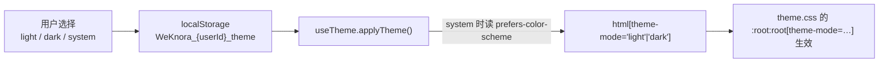
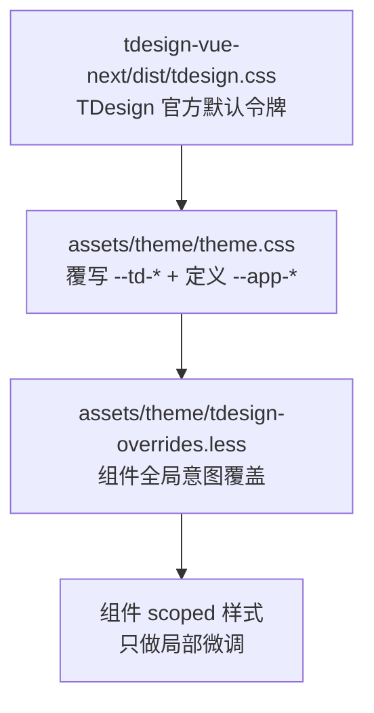
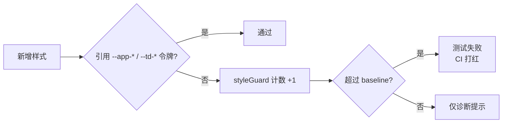

# WeKnora 前端设计系统（TDesign Design System）

> 本文描述本项目前端（`frontend/`）基于 **TDesign Vue Next** 建立的设计系统：设计语言、主题机制、
> 设计令牌、字体系统、TDesign 覆盖层、样式治理与离线约束。
>
> 阅读对象：前端开发、UI 设计、评审者。文中所有结论均以代码库实际实现为准，
> 关键文件：`src/assets/theme/theme.css`、`src/assets/theme/tdesign-overrides.less`、
> `src/assets/theme/styleGuard.test.mjs`、`src/composables/useTheme.ts`、`src/composables/useFont.ts`。

---

## 1. 定位与原则

本项目前端**不另起一套组件库**，而是以 TDesign 为唯一组件基座，在其上做三层叠加：

1. **令牌层**（`theme.css`）：覆写 TDesign 的 `--td-*` 变量，并定义应用级 `--app-*` 令牌。
2. **覆盖层**（`tdesign-overrides.less`）：只做「全局意图」级别的组件外观统一。
3. **组件层**（`views/`、`components/` 内的 `<style scoped>`）：只做局部微调。

核心约定（来自代码注释原文）：

> 对 TDesign 组件的全局意图覆盖。组件内只做局部微调，不要在 scoped 样式里用 `!important` 和 TDesign 打架。

四条不可违背的原则：

| 原则 | 说明 | 强制手段 |
| --- | --- | --- |
| 令牌优先 | 圆角/字号/间距/动效/层级一律引用令牌，禁止字面量 | `styleGuard.test.mjs` 棘轮计数 |
| 品牌色单一来源 | 透明叠加必须用 `color-mix(in srgb, var(--td-brand-color) N%, transparent)` | `brand-rgba` 规则 baseline = 0 |
| 不写 `!important` | `!important` 意味着在和 TDesign 打架，全局覆盖统一放覆盖层 | `important` 规则棘轮 |
| 离线可用 | 不得请求 `tdesign.gtimg.com` 的 iconfont CDN | `tdesign-icon-offline.ts` 运行时阻断 |

---

## 2. 设计语言与品牌色

### 2.1 品牌主色：绿色系

项目品牌色是**绿色**（非 TDesign 默认蓝）。浅色模式主色取色阶第 4 档 `#07c05f`，
深色模式主色取第 6 档 `#06b04d`（深浅两套色阶方向相反，保证对比度）。

浅色 `--td-brand-color-1..10`：

| 令牌 | 值 | 令牌 | 值 |
| --- | --- | --- | --- |
| `-1` | `#e9f8ec` | `-6` | `#049b38` |
| `-2` | `#09f479` | `-7` | `#038626` |
| `-3` | `#08dd6e` | `-8` | `#027218` |
| `-4` | `#07c05f`（主色） | `-9` | `#015e0d` |
| `-5` | `#06b04d` | `-10` | `#004b05` |

深色 `--td-brand-color-1..10` 为反向排列：`-1` 是 `#06b04d20`（浅色淡底），
`-6` 是 `#06b04d`（主色），`-10` 是 `#a6fccf`。

派生态绑定：

```css
/* 浅色 */
--td-brand-color: var(--td-brand-color-4);      /* 主色 */
--td-brand-color-hover: var(--td-brand-color-3);
--td-brand-color-active: var(--td-brand-color-5);
--td-brand-color-light: var(--td-brand-color-1);
--td-brand-color-disabled: #8ce0af;
--td-brand-color-focus: color-mix(in srgb, var(--td-brand-color) 20%, transparent);

/* 深色：主色换到第 6 档，hover/active 顺移，focus 浓度提到 28% */
--td-brand-color: var(--td-brand-color-6);
--td-brand-color-hover: var(--td-brand-color-5);
--td-brand-color-active: var(--td-brand-color-7);
--td-brand-color-disabled: #1a6b3b;
```

另设别名 `--brand-main`（浅色 = `-4`，深色 = `-6`）供非 TDesign 场景引用。

### 2.2 语义色与中性色

- **warning / error / success**：沿用 TDesign 官方 10 阶色板（浅色 + 深色两套），
  语义别名分别绑定到第 5（success 为 `#00a870`）、第 6（error 为 `#e34d59`）、第 5（warning 为 `#ed7b2f`）档。
- **中性灰**：`--td-gray-color-1..14`，浅色用于页面/容器/边框，深色用于页面底色（`-14` `#181818`）
  到容器（`-13` `#242424`）。
- **文字层级**：`--td-font-gray-1..4`（90% / 60% / 40% / 26% 黑）映射到
  `--td-text-color-primary/secondary/placeholder/disabled`；深色模式改用白色同透明度梯度

### 2.3 应用级强调色（非品牌但反复出现的语义色）

智能体、图谱等场景需要与品牌绿区分，故定义三枚强调色（透明叠加请用 `color-mix`）：

```css
:root {
  --app-accent-purple: #7c4dff;   /* 智能体 */
  --app-accent-blue:   #2f6bff;
  --app-accent-teal:   #0f8f83;
}
:root[theme-mode="dark"] {
  --app-accent-purple: #9d7cff;
  --app-accent-blue:   #6f9bff;
  --app-accent-teal:   #3cc4b4;
}
```

### 2.4 引用原文定位高亮（纸面荧光笔色）

RAG 回答引用原文时用于定位高亮，采用暖黄「荧光笔」语义，与品牌绿互补：

```css
:root {
  --app-source-highlight:          #d6a124;                    /* 文字/描边 */
  --app-source-highlight-bg:       rgba(250, 204, 75, 0.34);   /* 整块高亮 */
  --app-source-highlight-soft-bg:  rgba(250, 204, 75, 0.09);   /* 弱高亮 */
  --app-source-highlight-border:   rgba(183, 130, 22, 0.5);
}
/* 深色模式整体提亮：--app-source-highlight: #e6b94f 等 */
```

---

## 3. 主题机制（light / dark / system）

### 3.1 切换方式：`theme-mode` 属性

主题通过 `<html>` 上的 `theme-mode` 属性切换，`theme.css` 用**双冒号提升特异性**的选择器承接：

```css
:root:root,
:root:root[theme-mode="light"] { /* 浅色令牌 */ }

:root:root[theme-mode="dark"]  { /* 深色令牌 */ }
```

`theme-mode` 的**合法取值只有 `light` 和 `dark`**；`system` 是用户偏好，
在写入 DOM 前被解析为实际值：



### 3.2 运行时实现（`useTheme.ts`）

- 类型：`ThemeMode = 'light' | 'dark' | 'system'`，**默认 `light`**。
- 全局单例 `currentTheme` ref，跨组件共享。
- `applyTheme()` 内部有 `lastEffective` 短路：有效值未变则不重复写 DOM。
- `initTheme()` 在 `main.ts` 中于挂载前调用；若偏好为 `system`，
  则监听 `matchMedia('(prefers-color-scheme: dark)')` 的 `change` 事件实时跟随系统。
- `reloadThemeFromStorage()` 在登录/登出后调用，先做偏好迁移再重读。

### 3.3 首屏防闪动（`index.html` 内联脚本）

在样式表加载前，用内联脚本抢先写入 `theme-mode` 与页面底色，避免「白底闪一下再变深色」：

```html
<script>
  var t = localStorage.getItem('WeKnora_theme') || 'light';
  if (t === 'system') t = matchMedia('(prefers-color-scheme:dark)').matches ? 'dark' : 'light';
  document.documentElement.setAttribute('theme-mode', t);
  var bg = t === 'dark' ? '#181818' : '#eee';   // 与 theme.css 的 --td-bg-color-page 对齐
  document.documentElement.style.background = bg;
  document.documentElement.style.colorScheme = t;
  // 桌面端（Wails）同步设置窗口深色主题
</script>
```

> 注意：内联脚本读的是**旧的无命名空间键** `WeKnora_theme`（首屏最快路径，尽力而为），
> 而运行时真正生效的是用户命名空间键 `WeKnora_${userId}_theme`，两者由
> `preferenceStorage.ts` 的一次性迁移逻辑衔接。修改主题键名时需同步这两处。

### 3.4 用户级偏好存储（`preferenceStorage.ts`）

主题与字体偏好**按用户命名空间隔离**，防止多账号互相串味：

```
键名：WeKnora_${userId}_${suffix}
suffix ∈ { theme, font_sans, font_mono, font_size }
userId：当前登录用户 id；未登录时为 "anon"
```

登录时执行一次性迁移：优先承接 `anon` 命名空间，其次承接历史无命名空间键
（`WeKnora_theme` 等），随后删除源键。所有读写包裹 try/catch（配额超限、隐私模式不崩 UI）。

---

## 4. 设计令牌体系

令牌分两大类，**边界清晰**：`--td-*` 是 TDesign 的契约，`--app-*` 是本应用的契约。



### 4.1 应用级令牌（`--app-*`，定义于 `theme.css` 末尾）

原文注释即设计意图：

> 按代码库的事实刻度整理（圆角 4/6/8/10/12、字号 10~24、4px 间距网格、150/200ms 动效），
> 值与既有写法一致，目的是让后续调整只改这里。新代码请引用令牌，样式守卫会统计残留字面量。

**圆角**

| 令牌 | 值 | 典型用途 |
| --- | --- | --- |
| `--app-radius-xs` | `4px` | 标签、小徽标 |
| `--app-radius-sm` | `6px` | 小按钮、输入框 |
| `--app-radius-md` | `8px` | 卡片、按钮 |
| `--app-radius-lg` | `10px` | 面板 |
| `--app-radius-xl` | `12px` | 大卡片、悬浮面板（配合 `.wk-popover`） |
| `--app-radius-pill` | `999px` | 胶囊、头像 |

**字号**

| 令牌 | 值 | 令牌 | 值 |
| --- | --- | --- | --- |
| `--app-text-2xs` | `10px` | `--app-text-lg` | `15px` |
| `--app-text-xs` | `11px` | `--app-text-xl` | `16px` |
| `--app-text-sm` | `12px` | `--app-text-2xl` | `18px` |
| `--app-text-md` | `13px` | `--app-text-3xl` | `20px` |
| `--app-text-base` | `14px` | `--app-text-4xl` | `24px` |

**间距（4px 网格）**：`--app-space-1: 4px` … `--app-space-10: 40px`
（提供了 1/2/3/4/5/6/8/10 共 8 档，缺 7、9）。

**动效时长**

| 令牌 | 值 | 场景 |
| --- | --- | --- |
| `--app-motion-instant` | `120ms` | 即时反馈 |
| `--app-motion-fast` | `150ms` | hover / 颜色过渡 |
| `--app-motion-base` | `200ms` | 面板展开、默认值 |
| `--app-motion-slow` | `300ms` | 抽屉、模态进场 |

**层级（z-index）**——注释给出了完整语义：

> 页面内 sticky < 下拉 < 全屏弹窗壳 < TDesign 抽屉/弹窗(2500) < 弹层 < 通知

| 令牌 | 值 | 说明 |
| --- | --- | --- |
| `--z-sticky` | `10` | 页面内吸顶 |
| `--z-dropdown` | `1000` | 下拉 |
| `--z-modal` | `1100` | 全屏弹窗壳 |
| `--z-drawer` | `2500` | 对齐 TDesign 抽屉/弹窗 |
| `--z-popover` | `3000` | 弹层 |
| `--z-toast` | `5000` | 通知 |

**其他应用令牌**

| 令牌 | 值 | 用途 |
| --- | --- | --- |
| `--app-chat-header-height` | `40px` | 对话标题与右侧面板共用同一条头部分割线 |
| `--app-font-family` | 系统字体栈 | 见 §5 |
| `--app-font-family-mono` | 等宽字体栈 | 见 §5 |
| `--app-selection-bg` | `color-mix(文字色 4%, 容器底色)` | 选中态安静底色 |
| `--app-selection-text` | `--td-text-color-primary` | 选中态文字 |
| `--app-selection-border` | `color-mix(品牌色 30%, 描边色)` | 选中态描边 |
| `--app-focus-border` | `--td-brand-color` | 聚焦描边 |

### 4.2 TDesign 令牌覆写（`--td-*`）

`theme.css` 覆写的 TDesign 令牌域：

- **色彩**：`--td-brand-color-*`、`--td-warning-*`、`--td-error-*`、`--td-success-*`、
  `--td-gray-color-1..14`、`--td-bg-color-*`、`--td-component-stroke/border`、
  `--td-text-color-*`、`--td-font-white/gray-*`。
- **圆角**：`small 2px / default 3px / medium 6px / large 9px / extraLarge 12px / round 999px / circle 50%`。
- **字体**：`--td-font-family` = `--app-font-family`（用户换字体后可贯穿整个 TDesign），
  `--td-font-family-mono` = `--app-font-family-mono`。
  字号体系：body `12/14/16`、title `14/16/20`、headline `24/28/36`、display `48/64`；
  行高统一 `font-size + --td-line-height-common(8px)`。
- **阴影**：`--td-shadow-1/2/3`（三级卡片投影）。

> 关于 `--td-*` 的 fallback：守卫规则 `td-token-fallback`（baseline = 0）禁止写
> `var(--td-xxx, 默认值)`，因为 `theme.css` 已保证令牌存在，fallback 永不生效且容易写错颜色。
> 仅有 `--td-purple-5`、`--td-cyan-6`、`--td-font-family-code` 被显式豁免。

### 4.3 全局通用样式（`theme.css` 中非令牌部分）

除令牌外，`theme.css` 还承担几处**全局且必须统一**的样式：

| 片段 | 作用 |
| --- | --- |
| `@keyframes wk-spin` | 全局旋转动画，spinner / 刷新图标统一用 `animation: wk-spin 0.8s linear infinite` |
| 深色滚动条 | `:root[theme-mode="dark"] *::-webkit-scrollbar-thumb` 覆盖 |
| 深色位图图标反转 | `.more-icon { filter: invert(1) }` |
| `.t-radio-button` 选中态 | 全局填充品牌色（绿底白字），禁用态用 `--td-brand-color-disabled` |
| `.doc-link` | 全局文档/外链：品牌色文字 + 图标，hover 加下划线 |
| autofill 覆盖 | `input:-webkit-autofill` 用 inset box-shadow 抹掉浏览器浅蓝/浅黄底色 |
| 输入聚焦 | 保留细绿描边（同 hover），去掉粗外发光环（`t-input` / `t-textarea`） |

---

## 5. 字体系统（`useFont.ts`）

### 5.1 两个字体维度 + 一个字号维度

- **无衬线（sans）**：`FontKey` 联合类型，覆盖 `system / pingfang / georgia / yahei / times / noto-cjk / dejavu-serif / sans-serif`。
- **等宽（mono）**：`MonoFontKey`，覆盖 `system / menlo / monaco / consolas / cascadia / dejavu-mono / liberation-mono / monospace`。
- **字号**：`FontSizeKey = 'small' | 'normal' | 'large'`，对应缩放 `0.875 / 1 / 1.125`。

### 5.2 平台适配：只展示该 OS 真实存在的字体

字体选项**按宿主平台过滤**，避免「选了 PingFang 却渲染成雅黑」的标签说谎问题。
`detectPlatform()` 优先读 `navigator.userAgentData.platform`（Chromium/Edge/Wails），
UA 字符串兜底，未知平台回退 `mac`。

| 平台 | sans 可选 | mono 可选 |
| --- | --- | --- |
| mac | system / pingfang / georgia / sans-serif | system / menlo / monaco / monospace |
| windows | system / yahei / times / sans-serif | system / consolas / cascadia / monospace |
| linux | system / noto-cjk / dejavu-serif / sans-serif | system / dejavu-mono / liberation-mono / monospace |

> 每个平台第三个 sans 槽位是**衬线体**（Georgia / Times / DejaVu Serif），这是刻意设计：
> macOS 上系统无衬线、PingFang、Helvetica 视觉过于接近，加一个衬线选项才让设置「看起来有反应」。

所有 key 共用一个联合类型，持久化值跨设备稳定；换平台后运行时只隐藏不匹配的子集，
字体栈本身仍可用（浏览器自行回退）。

### 5.3 应用方式：CSS 变量 + `zoom`

```ts
// 字体族：写 CSS 变量
root.style.setProperty('--app-font-family', sansStack)
root.style.setProperty('--app-font-family-mono', monoStack)
// 字号：写在 <html> 上的 zoom，整体等比缩放
root.style.setProperty('zoom', scale)   // '0.875' | '1' | '1.125'
```

**为什么用 `zoom` 而不是 `font-size` 变量**（原文注释）：

> 前端散落着上千条硬编码 `font-size: NNpx`，早期用 `--app-font-scale` + `calc()` 只在消费该变量的
> 少数地方生效，用户只能看到部分 UI 缩放。`zoom` 会把整篇文档按倍数合成，且 Chromium / WebKit /
> 现代 Firefox(126+) 均支持。

`applyFont()` 内部用 `lastApplied` 记录已写值，三个旋钮只改一个时不触发无谓的样式重算。

---

## 6. TDesign 覆盖层与组件皮肤（`tdesign-overrides.less`）

### 6.1 覆盖层纪律

- 覆盖层只放「全局意图」，用**两级选择器**压过 TDesign 默认样式，**不用 `!important`**。
- 需要局部微调的，回到组件 `<style scoped>` 里做，不要在这里堆砌组件特例。

### 6.2 悬浮面板皮肤 `.wk-popover`

给 `t-popup` / `t-select` 等的 `overlayClassName` 加上 `wk-popover` 即可获得统一皮肤：

```less
.wk-popover .t-popup__content {
  padding: 0;
  border-radius: var(--app-radius-xl);            /* 12px */
  background: var(--td-bg-color-container);
  border: 0.5px solid var(--td-component-stroke);
  box-shadow: 0 0 0 0.5px rgba(0,0,0,.03), 0 2px 4px rgba(0,0,0,.04), 0 8px 24px rgba(0,0,0,.1);
  backdrop-filter: blur(20px) saturate(180%);
  overflow: hidden;                                /* 需要圆角裁切 */
}
:root[theme-mode="dark"] .wk-popover .t-popup__content {
  background: rgba(36, 36, 36, 0.92);
  border-color: rgba(255, 255, 255, 0.08);
}
```

两个配套变体：

- `.t-select__dropdown.wk-popover .t-popup__content { overflow-y: auto }`
  —— `overflow:hidden` 会顺带砍掉 TDesign 给下拉列表的滚动，导致首屏之外的选项「够不着」而非仅仅看不见。
- `.wk-popover.wk-popover--form .t-popup__content`
  —— 菜单项自带间距所以 `padding:0` 合适，但承载表单（邀请、建用户、改密码）的弹层没有内边距，
  加 `wk-popover--form` 找回边框留白并允许滚动：`padding: 14px 16px; min-width:300px; max-width: min(392px, 100vw-24px); max-height: min(480px, 100vh-96px)`。

### 6.3 选中态：安静底 + 品牌色对勾

```less
/* 选中行用极淡底色，不靠颜色单独表达状态 */
.t-select-option.t-is-selected:not(.t-is-disabled) {
  background-color: var(--app-selection-bg);
  color: var(--td-text-color-primary);
  font-weight: 500;
}
/* 单选菜单末尾补一个品牌色小对勾，与 hover 区分开（非仅颜色差异） */
.t-select-option.t-is-selected:not(.t-is-disabled):not(:has(.t-checkbox))::after {
  content: ''; width: 5px; height: 9px; margin-left: auto; margin-right: 2px;
  color: var(--td-brand-color);
  border: solid currentColor; border-width: 0 1.5px 1.5px 0;
  transform: translateY(-1px) rotate(45deg);
}
```

---

## 7. 样式治理：棘轮守卫（`styleGuard.test.mjs`）

设计系统能长期成立，靠的不是自觉，而是**会把 CI 打红的棘轮测试**。

### 7.1 原理

- 扫描 `src/views`、`src/components`、`src/assets` 下的 `.vue/.less/.css`（排除 `*.test.*`，
  豁免 `assets/theme/theme.css`）。
- 对每条规则统计「违规写法」出现次数，**只允许计数下降**：
  - 计数 > baseline：测试失败，打印违规位置与整改建议；
  - 计数 < baseline：不算失败，但打印诊断，提示把 baseline 下调到实际值
    （避免两个各自清理并下调 baseline 的 PR 先后合并时 main 变红）。
- 先去注释（保留换行以维持行号准确），注释里的示例代码不计入；
  `//` 仅在行首或空白后视为 Less 行注释，`https://` 不受影响。



### 7.2 规则与当前 baseline

| 规则 | 拦截的写法 | baseline | 整改建议 |
| --- | --- | --- | --- |
| `brand-rgba` | `rgba(7,192,95,…)` 品牌色硬编码 | **0** | 改 `color-mix(in srgb, var(--td-brand-color) N%, transparent)`，否则深色不跟随 |
| `legacy-blue-rgba` | `rgba(0,82,217,…)` 旧版 TDesign 蓝 | 7 | 已不是品牌色，替换为令牌 |
| `td-token-fallback` | `var(--td-xxx, 默认值)` | **0** | 令牌必然存在，fallback 永不生效 |
| `radius-literal` | `border-radius: NNpx` | 160 | 用 `var(--app-radius-xs…pill)` |
| `font-size-literal` | `font-size: NNpx` / `font: NNpx…` | 33 | 用 `var(--app-text-2xs…4xl)`；图标尺寸用 `t-icon` 的 `size` 属性 |
| `motion-literal` | `transition` 中的 `0.2s` / `200ms` | 64 | 用 `var(--app-motion-instant…slow)` |
| `transition-all` | `transition: all` | 59 | 列出具体属性，避免 layout 属性被动画 |
| `important` | `!important` | 414 | 全局意图覆盖放 `tdesign-overrides.less` |
| `z-index-important` | `z-index: 9999 !important` | 23 | 用 `t-popup attach="body"` 或 `--z-*` 令牌 |
| `raster-icon` | `more.png` / `circle.png` 位图图标 | 8 | 换成 `t-icon` |

> **baseline 只降不升**。清理代码后应主动下调对应数值（测试会提示目标值）。
> `brand-rgba` 与 `td-token-fallback` 的 baseline 为 0，即**零容忍**。

### 7.3 运行方式

```bash
cd frontend
npm test          # tsx --test，自动发现 .mjs / .test.ts 文件
```

测试文件用 `.mjs` 的原因（原文注释）：`npm test`（`tsx --test`）在 Node 20 下只自动发现 `.mjs` 测试文件。

---

## 8. 离线图标策略（`tdesign-icon-offline.ts`）

### 8.1 问题

`tdesign-icons-vue-next` 的 `Icon` / `IconFont` 组件在 `onMounted` 时会通过
`checkScriptAndLoad` / `checkLinkAndLoad` 往 document 注入指向
`https://tdesign.gtimg.com/icon/<version>/fonts/index.(js|css)` 的节点。
**无外网环境下请求失败 → 图标全部不渲染**（issue #867 / #897）。

### 8.2 方案：预插占位节点 + 本地 sprite

1. 在 Vue app 挂载**之前**（`main.ts` 中 `installTDesignIconOfflineGuard()`）插入符合 TDesign
   去重选择器的占位节点：

   ```
   script.t-svg-js-stylesheet--unique-class[src="…/index.js"]
   link.t-iconfont-stylesheet--unique-class[href="…/index.css"]
   ```

   TDesign 的 `checkScriptAndLoad` / `checkLinkAndLoad` 去重判断命中后直接返回，
   不再追加指向 CDN 的真实节点。

2. 占位节点用**非标准 type / rel**，浏览器不会真的发起请求：

   ```html
   <script type="text/no-load" class="t-svg-js-stylesheet--unique-class" src="…"></script>
   <link rel="preload-blocked" class="t-iconfont-stylesheet--unique-class" href="…">
   ```

3. 真实图标符号由 `index.html` 的本地 `<script src="/tdesign-icons/<ver>/fonts/index.js">`
   提前注册 SVG sprite，`<t-icon name="…">` 因此仍可正常渲染。

4. 阻断版本号对齐 `0.4.x`：`["0.4.0","0.4.1","0.4.2","0.4.3","0.4.4"]`，兼容潜在升级。

> **升级提醒**：`package.json` 把 `tdesign-icons-vue-next` 锁在 `0.4.4`
> （`dependencies` + `overrides` + `resolutions` 三处），而 `index.html` 引用的本地 sprite 是
> `0.4.1`。升级图标库时，需同步更新 `public/tdesign-icons/<version>/fonts/index.js`
> 与 `index.html` 的引用版本（`index.html` 内注释已标注此约束）。

---

## 9. 工程集成

### 9.1 样式加载顺序（`main.ts`）——顺序即契约

```ts
import "tdesign-vue-next/dist/tdesign.css";          // 1. TDesign 官方默认
import "@/assets/theme/theme.css";                    // 2. 令牌覆写 + --app-*
import "@/assets/theme/tdesign-overrides.less";       // 3. 组件全局意图覆盖
import "@/assets/dropdown-menu.less";                 // 4. 组件级全局样式
import "@/components/css/chat-hljs-dark.less";        // 5. 代码高亮深色
import "vue-virtual-scroller/dist/vue-virtual-scroller.css";
```

挂载前初始化的三件事，顺序同样敏感：

```ts
installTDesignIconOfflineGuard();   // 必须早于 app.mount，否则 icon 已发起 CDN 请求
initTheme();                        // 写 theme-mode
initFont();                         // 写 --app-font-family / zoom
```

> `vite.config.ts` 的 `preview` 注释明确指出：`vite preview` 复现生产构建的**压缩 / 拆包 / CSS 加载顺序**，
> 用来提前暴露「主题变量被打包顺序覆盖」这类只在生产出现的问题。

### 9.2 构建（`vite.config.ts`）

- **多入口**：`index.html`（主 SPA）+ `embed.html`（嵌入式会话）。
- **注入常量**：`__FRONTEND_VERSION__`、`__FRONTEND_COMMIT__`。
- **手拆 chunk**：`vendor-mermaid`（mermaid/dagre/cytoscape）、`vendor-markdown`（marked/katex）、
  `vendor-highlight`（highlight.js）。
- **embed 预加载裁剪**：`modulePreload.resolveDependencies` 在 embed 入口过滤掉
  `vendor-mermaid / vendor-highlight / vendor-markdown / vendor-tdesign / botmsg / usermsg / …`，
  因为嵌入式 iframe 仅做 token 交换启动，重聊天 chunk 应延迟加载。
- **别名**：`@` → `src`；`@vue-office/pptx` 指向实际存在的入口。

---

## 10. 新增样式/组件检查清单

写前端样式前逐条自查：

- [ ] 颜色：品牌色只用 `var(--td-brand-color*)`；透明叠加用 `color-mix(in srgb, var(--td-brand-color) N%, transparent)`，不写 `rgba(7,192,95,…)`。
- [ ] 圆角：用 `var(--app-radius-xs|sm|md|lg|xl|pill)`，不写 `border-radius: 8px`。
- [ ] 字号：用 `var(--app-text-2xs…4xl)`；图标尺寸用 `t-icon` 的 `size` 属性，不用 `font-size`。
- [ ] 间距：用 `var(--app-space-N)`（4px 网格）。
- [ ] 动效：用 `var(--app-motion-instant|fast|base|slow)`；不用 `transition: all`。
- [ ] 层级：用 `var(--z-sticky|dropdown|modal|drawer|popover|toast)`，不用 `z-index: 9999 !important`。
- [ ] 深色：新色值必须同时给出 `:root[theme-mode="dark"]` 覆盖，或用 `color-mix` 让品牌色自动跟随。
- [ ] 全局覆盖：只放 `tdesign-overrides.less`；组件内不用 `!important` 和 TDesign 对抗。
- [ ] 图标：用 `t-icon` / SVG sprite，不用 `more.png` 之类的位图。
- [ ] 悬浮层：需要统一皮肤时给 `overlayClassName` 加 `wk-popover`；表单弹层再加 `wk-popover--form`。
- [ ] 令牌 fallback：不写 `var(--td-xxx, 默认值)`。
- [ ] 提交前跑 `npm test`，确认 `styleGuard` 全绿；清理后记得下调 baseline。

---

## 附录：关键文件索引

| 文件 | 职责 |
| --- | --- |
| `src/assets/theme/theme.css` | 设计令牌源头：`--td-*` 覆写 + `--app-*` 定义 + 全局通用样式 |
| `src/assets/theme/tdesign-overrides.less` | TDesign 组件全局意图覆盖、`.wk-popover` 皮肤 |
| `src/assets/theme/styleGuard.test.mjs` | 样式棘轮守卫（10 条规则 + baseline） |
| `src/composables/useTheme.ts` | 主题模式（light/dark/system） |
| `src/composables/useFont.ts` | 字体族与字号（平台适配 + zoom 缩放） |
| `src/composables/preferenceStorage.ts` | 用户级偏好存储与迁移 |
| `src/utils/tdesign-icon-offline.ts` | 阻断 tdesign-icons 的 CDN 请求 |
| `src/main.ts` | 样式加载顺序与初始化时机 |
| `index.html` | 首屏防闪动内联脚本 + 本地 SVG sprite 预加载 |
| `vite.config.ts` | 多入口、chunk 拆分、embed 预加载裁剪 |
